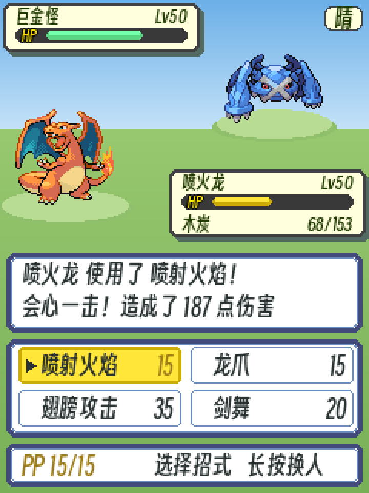
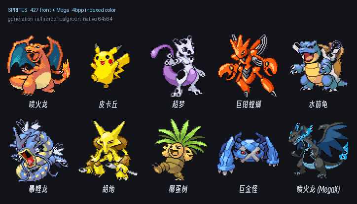
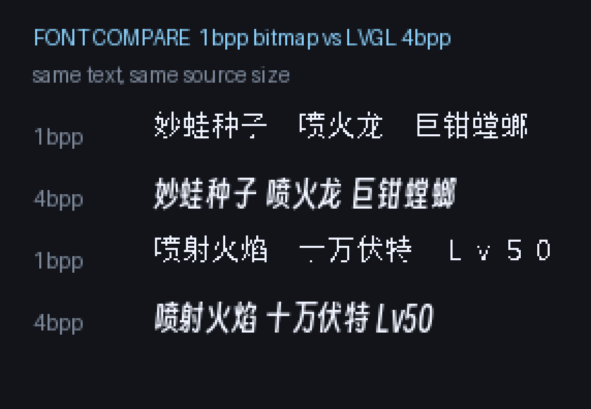

# poke-battle

**在 FoloToy AI Passport 上跑的宝可梦对战引擎。** 第六代能力值与伤害公式 + 三代图鉴
（386 只 + 41 个 Mega 形态），纯 C11，**无动态内存、无 I/O**，因此能在 PC 上把一整局
6v6 跑完并断言每一步的结果。

<p align="center">
  
</p>

<p align="center"><sub>
战斗界面（240×320 原生分辨率 ×3）。这张图由 <code>tools/make_readme_images.py</code>
用 Python 独立画出，与固件渲染层画的同一屏（<code>make screen-preview</code>）
逐像素比对通过 —— 所以它同时是「固件会画出什么」的可信 preview。
血量与日志是摆出来的示意值，真机开局是满血。
</sub></p>

| | |
|---|---|
| 目标平台 | FoloToy AI Passport：ESP32-C3，8 MB Flash，**无 PSRAM**，240×320 屏，3 个实体键 |
| Flash 占用 | ~1.03 MB / 8 MB（13%），其中精灵图 867 KB |
| 数据规模 | 386 种族 + 41 Mega / 354 招式 / 251 特性 / 383 道具 / 25 性格 |
| 测试 | **1109 项断言全过，零编译警告**（`make test`，约 50 秒） |
| AI 强度 | 200 局 6v6 对随机手 **72%**，同批种子随机基线 54% |
| 进度 | 数据层 + 规则层 + AI + 渲染层（含菜单）+ 输入与界面状态机 + 会话层完成，**已可在 PC 上试玩**；剩**队伍配置**与 **NVS 存档** |
| 许可 | MIT（仅覆盖本项目代码；精灵图与字库是第三方衍生物，见[许可](#许可)） |

```bash
git clone https://github.com/gefeimu/poke-battle.git && cd poke-battle
make play            # 在电脑上开窗口试玩一局 6v6（Windows，键盘操作）
make test            # 编译并跑全部测试
make bench           # AI 决策耗时剖析
make sprites-preview # 把固件里的精灵图导成 PNG 看画质
```

克隆下来即可构建：`gen/` 里的生成产物已入库（源数据 14 MB 见
[数据来源与重建方法](docs/data-sources.md)）。

> 自用学习项目。宝可梦相关设计版权归任天堂 / Creatures / GAME FREAK 所有。
> 代码采用 [MIT 许可](#许可)；第三方数据与字体不受 MIT 覆盖，见[许可](#许可)。

---

## 目标需求

### 对战规则

| 项目 | 要求 |
|---|---|
| 模式 | 本地单机对战 |
| 队伍 | 6v6，完整对局 |
| 等级 | 默认 50 |
| 换人 | 支持，含行动顺序与Mega 触发时机 |
| 道具 | 可携带，战斗中使用 |
| 队伍配置 | 玩家自选 6 只 vs 6 只随机，或对战预置强队 |
| 个体值 | 努力值可调（6 项 × 0~255） |
| 性格 | 可调（25 种，±10%修正） |
| Mega 进化 | 支持（52 个形态，仅限三代宝可梦） |
| 精灵图 | 火红/叶绿版 64×64 正面立绘 + Mega（统一 64×64） |
| 中文显示 | 两套可选：自制 14×14 点阵（35 KB）或 LVGL 16px 4bpp 抗锯齿（121 KB），均 1295 字 |

### AI 要求（核心）

**AI 不能太笨。** 这是整个项目的重点，需要能达到"练习对战"的价值：

- 会算属性克制，不会用克制招打不划算的局面
- 懂换人时机（对手上了克我的，要能换掉）
- 会评估净收益（克制但只有 30% 命中且会暴击被反杀，就不该用）
- 懂资源管理（PP 够不够、要不要留收尾的）
- 分难度等级：简单 / 普通 / 困难 / 大师 / 大师+

算力已验证充足：ESP32-C3 单次伤害计算约 0.0006 ms，5 ms 预算可搜索 8888 个节点，足够 4 层以上完整前瞻。**瓶颈不在算力，在评估函数质量。**

### 无现成 AI 可用

Pokémon Showdown 的 `sim/bots/` 已从 master 移除，只剩 `RandomPlayerAI`（纯随机）。第三方 AI（Technical Machine 等）都是 TypeScript/Python 且依赖 PS 引擎做前向模拟，无法移植到 8 MB Flash。

**可借鉴的是算法而非代码**：Technical Machine 的状态评估权重表（纯数学，可翻成 C）、Showdown 的招式与克制数据。

---

## 硬件约束

| 资源 | 总量 | 本项目占用 |
|---|---|---|
| Flash | 8 MB | ~1.01 MB（12.6%） |
| SRAM | ~380 KB 可用 | ~75 KB（20%） |
| 屏幕 | 240×320 RGB565 | 上半屏 240×160 战斗场景 + 下半屏菜单 |
| 按键 | 3 个（▲▼ OK） | 上下移动光标 / 短按确认 / 长按返回 |
| 电池 | 500 mAh | 纯单机，不联网 |

屏幕 240×320 正好是 GBA 原生 240×160 的两倍，可上下分屏还原初代版式。

**关键优化**：不联网可省下 60~80 KB SRAM（Wi-Fi 协议栈）。

---

## 界面设计

<p align="center">
  
</p>

<p align="center"><sub>版式、框体尺寸与配色全部取自三代原版（火红/叶绿），不是自己设计的。
图由 <code>make readme-images</code> 从固件数据生成。</sub></p>

### 版式：照三代原版摆

屏幕 240×320 正好是 GBA 原生 240×160 的两倍，于是：

| 屏区 | 内容 |
|---|---|
| y = 0–159 | **完整复刻原版战斗画面**：双方立绘 + 两个血条框 |
| y = 160–319 | 对话框（战斗日志）+ 招式菜单 + 状态行 |

原版把对话框压在画面底部那 48 px 里，血条框和对话框是挤在一起的；我们高一倍，
正好可以把对话框整块挪到下半屏，两个血条框都完整可见。

版式数值是**从反编译仓查出来的，不是估的**（`pret/pokefirered`）：

| 项 | 原版值 | 出处 |
|---|---|---|
| 对手血条框 | **128×32**，左上角内缩 `(2,2)` | OAM 是 `SPRITE_SHAPE(64x64)` 的**两个**精灵拼合 → 宽 128 |
| 我方血条框 | **128×44**，右下角内缩 `(110,110)` | 原版是 128×64，因为它最下面压着一条 EXP 条；本项目不用 EXP，压到 44 才不留空白 |
| 摆放 | 左上 / 右下**对角**，各占半屏宽 | 原版即如此 |
| 框体 | 米白填充 `#FFFFDE` + 深灰描边 `#414141` + 右下墨绿投影 `#526A62` | `graphics/battle_interface/healthbox.pal` |
| 离屏幕边距 | 两个框都留 **2 px** 缝隙（不贴边） | 本项目调整 |
| 框内文字 | 名字与数字用 **12 px** 那套字库（16 px 在小框里明显偏大） | 本项目调整 |
| HP 标签字号 | 再小一号，用 **10 px** 那套（`gen/font_hp_10.c`，只含 ASCII 段） | 本项目调整 |
| HP 条 | **双色立体**：上行高光 + 下行基色，外套深色槽 | `healthbar.pal` |
| HP 条形态 | **「HP」标签嵌在条的左端，与条是一个整体**（不是「左边一个 HP 文字 + 右边一条独立的条」）。标签金色 `#FFE600` + 黑描边。**两个框都有标签** | `healthbox.pal[9]` |
| HP 行高 | **10 px**（要容纳嵌入的标签；其中彩色填充 6 px），两端**圆角收成胶囊形**，与框体圆角统一 | 本项目调整 |
| HP 条三档色 | 绿 `#73FFAC`/`#5AD583`、黄 `#FFE639`/`#CDAC08`、红 `#FF5A39`/`#AC414A` | 同上 |
| 对话框 | 白底 + 深蓝外框 `#414A7B` + 浅蓝内框 `#6A8BBD` | `textbox1.pal` |
| 框内文字色 | 深绿 `#203900` | `healthbox.pal` |

「双色立体」这条值得单说：原版的 HP 条**不是单色矩形**，而是上行高光、下行基色
的两段式，外面再套一圈深色槽。按单色画会明显「不像」，所以 `hp_bar()` 按这个实现。

**立绘站台要按「可见像素」的下边界摆，不能按 64×64 画布的下边界。** 立绘画布
底部通常留一圈透明（巨金怪留了 6 px），按画布摆会让站台明显悬在脚底下。
`make_readme_images.py` 里用 `sprite.getbbox()[3]` 取真实脚底。

**「HP」标签是嵌在血条里的。** 一开始画成了「左边一个 HP 文字 + 右边一条独立的
短条」，看着散、横向也多占一个标签的宽度。原版是一个整体：深色胶囊，左端放
金色「HP」，其后才是彩色填充。分开画和整体画观感差别很明显。

### 字体相关的缺口

做这版界面时暴露出来的问题：

1. ~~**我们的字对血条框偏大。**~~ **已解决**：另生成了一套 **12 px** 的 LVGL
   字体（`gen/font_app_12.c`，73 KB）专供血条框，对话框仍用 16 px。
   原版血条框里的字约 8 px 高，12 px 已经接近。
2. **自制 1bpp 字库的 ASCII 是全角等宽。** 每个字母占满 14 px，`68/153` 需要
   126 px，**塞不进 128 px 的血条框**。要做 GBA 风格界面，必须给 1bpp 字库
   补一套**半角 ASCII**（7 px 宽），否则 HP 数字和等级都没法排。

第 2 条只影响自制字库；LVGL 那套的 ASCII 本来就是比例宽度（见
[中文字库](#中文字库)），所以现在先用它出图。

### 模块划分

| 文件 | 职责 | 状态 |
|---|---|---|
| `src/poke_render.c/.h` | 绘制原语：RGB565 缓冲与裁剪、矩形/圆角矩形/椭圆/条、精灵图、位图文字 | ✅ |
| `src/poke_font.c/.h` | 位图字体的数据结构、查表、度量、UTF-8 解码 | ✅ |
| `src/poke_ui.c/.h` | 界面绘制：战斗界面（按三代原版版式）+ 七屏菜单界面（本项目自定版式） | ✅ |
| `test/dump_screen.c` | 把**七屏**各自导成图片，**不上硬件就能验收**（除战斗界面外都走真实会话） | ✅ |
| `src/poke_input.c/.h` | 三键驱动：ADC 电压 → 键位（含键位锁、去抖、短按/长按） | ✅ |
| `src/poke_ui_state.c/.h` | 界面状态机：界面栈 / 光标 / 滚动 / 连发，把按键翻译成「想做什么」 | ✅ |
| `src/poke_save.c/.h` | 队伍配置持久化：NVS，24 KB 分区约可存 100 支队 | ⏳ |
| `main/app_main.c` | ESP-IDF 入口：屏幕/按键初始化、lifecycle 任务 | ⏳ |

**绘制原语是自己写的**（`poke_render.c`），没有用 LVGL。理由：

1. **能在主机侧完整测试**。本项目的约定是所有逻辑都能在 PC 上跑断言，
   渲染也不例外 —— `test/dump_screen.c` 直接把画面导成图片，不用上硬件。
   LVGL 需要一整套初始化，主机侧跑不起来。
2. 界面只有 4 组、控件种类很少，原语十几个就够，引入 LVGL 不划算。
3. 目标板无 PSRAM，LVGL 的 widget 树与样式表是纯开销。

代价是控件要自己画。但界面样式已经按三代原版定死了（血条框 128x32、
对话框白底蓝框），用原语直接摆出来反而比用 widget 拼更准。

**字体走了一层转换**：`lv_font_conv` 生成的 LVGL 字体文件数组是 `static` 的、
且依赖 `lvgl.h`，`src/` 用不了；`tools/lvgl_font_to_c.py` 把它转成项目
自有格式（`gen/poke_font_data.c`），字形数据一字不改。理由见
`src/poke_font.h` 的注释。

### 4 组界面

| 界面 | 内容 |
|---|---|
| **队伍配置** | 386 只列表（可滚动/检索）+ 逐只编辑性格(25)/努力值(6×0-255)/个体值/道具(383)/4 个招式(354)，每个都是可滚动选择器；再加难度选择。**工作量最大的一块** |
| **战斗主界面** | 立绘走 `sprite_get(pid, SPR_FRONT)`；名字/等级/HP 从 `battle_active_c(b, side)` 读 `cur_hp`/`hp_max`；招式菜单用 `mv_get(id)->name_cn` + `m->pp[i]` |
| **战斗中弹层** | 换人 / 背包 / Mega 确认 / 认输。Mega 走 `battle_mega()`，**不消耗回合，必须在出招前调用**。**是「认输」不是「逃跑」**：6v6 是两个人对局，没有野生遇敌那套逃跑成功率，玩家只能主动弃权判负。认输**不可逆，要过一道确认界面** |
| **日志与结算** | 日志逐条播放；胜负画面读 `b->result` |

### 4 个必须处理的引擎接口约束

| 约束 | 处理方式 |
|---|---|
| `battle_step()` 返回 0/1/2/3 | 1 = 我方需换人，2 = 对方，3 = 双方。**返回值非 0 时必须先进强制换人界面**，不能直接进下一回合 |
| 出招与换人互斥 | 出招填 `b->my_action`（0..3）；换人填 `my_action = 0xFF` + `my_switch`。**换人消耗回合，双方都不出招** |
| 日志有开关 | 跑 AI 自对弈时可 `battle_log_enable(false)` 省掉 `vsnprintf` 开销；正式对局要开着 |
| 随机源统一 | 不能自己调 `rand()`，引擎的随机全部走 `battle_rng()`（这样单测才能固定种子重放） |

### 硬件侧三条事实（来自官方仓，我最初全估错了）

| 项 | 实际 | 我最初的估计 |
|---|---|---|
| 显示缓冲 | LVGL **部分刷新**，一个 `240×20` RGB565 ≈ **9.6 KB** | 以为要 150 KB 全屏帧缓冲，还担心放不下双缓冲 |
| 长按阈值 | **500 ms**（短按 180 ms） | 以为 800 ms |
| 按键接线 | 三键**共用 GPIO0**，靠电阻分压区分：上 0 mV / 下 300 mV / 确定 595 mV / 松开 3300 mV | 以为是三个独立 IO |

按键还有个具体的坑：**ADC 读失败必须当「未按下」，不能当 0 mV**，否则一次读错
就会被判成「上键被按住」。另外**不能用内部上拉**（45 kΩ 会把三档全挤进 0~154 mV）。
官方 BSP 里长按阈值特意从组件默认的 1500 ms 下调到 500 ms，理由是「在这台三键小设备上
明显偏迟钝」。

### 队伍配置可以挪到配套小程序

「队伍配置」是设备端最大的一块（386 项列表 + 7 个选择器）。替代方案是做成微信小程序、
用 BLE 把队伍推给设备，设备端只留「选第几队 → 对战 → 结算」。

配置数据量很小，传输毫无压力：

| 字段 | 字节 |
|---|---|
| 种族 id 2 + 等级 1 + 性格 1 + 特性 1 + 道具 2 | 7 |
| 4 个招式槽 4×2 | 8 |
| 努力值 6 + 个体值 6 | 12 |
| **单只合计** | **27** |

一队 6 只 = 162 字节，加头部（版本/序号/CRC16）约 **170 字节**。

唯一要留心的约束是 **BLE 默认 MTU 23 字节，扣掉 ATT 头只剩 20 字节有效载荷**；
`wx.setBLEMTU` 只在 Android 5.1+ 生效、**iOS 不支持**（调了不报错但不生效），
所以必须按 20 字节分包：170 字节 = 9 包，每包带序号 + 总包数 + 数据。
BLE 会丢包，收齐后要用头部 CRC 校验，失败要求重传。

**状态：仅讨论，未实现。** 无论是否做小程序，固件都应内置 1~2 支**只读预设队伍**——
否则「刚焊好的板子」和「手机不在身边」两种情况下设备完全没法玩。

---

## 渲染层

界面部分已经能**独立画出一整屏战斗画面**，不需要引擎、不需要硬件。
这是「渲染层最小闭环」，也是后面接引擎时的验收基准。

<p align="center">
  
</p>

<p align="center"><sub>这一屏由固件渲染层画出，`make screen-preview` 导成图片。</sub></p>

### 分三层

| 层 | 文件 | 职责 |
|---|---|---|
| 原语 | `src/poke_render.c/.h` | RGB565 缓冲与裁剪、矩形/圆角矩形/椭圆/渐变/条、4bpp 精灵图、位图文字 |
| 字体 | `src/poke_font.c/.h` | 字体的数据结构、二分查表、行宽度量、UTF-8 解码 |
| 界面 | `src/poke_ui.c/.h` | 战斗界面：血条框、对话框、招式菜单（按三代原版版式） |

界面层**不知道**什么是按键、什么是状态机，它只负责「给一份数据，画一屏」。
按键与状态机是下一步的事。

### 部分刷新：不占全屏帧缓冲

`Surface` 带 `origin`（缓冲左上角对应的屏幕坐标）与裁剪矩形，所以固件里可以
只开一块 240×N 的条带缓冲、逐条渲染，而不是一次性占 150 KB 全屏：

```c
static uint16_t band[240 * 20];          /* 9.6 KB，与官方 BSP 一个量级 */
r_init(&s, band, 240, 20, 240);
r_set_origin(&s, 0, 100);                /* 这条缓冲对应屏幕 y=100..119 */
r_fill_rect(&s, 0, 100, 240, 20, color); /* 绘制仍用屏幕坐标 */
r_fill_rect(&s, 0, 99, 240, 1, color);   /* 条带外的自动被裁掉 */
```

`test_render.c` 里有这条的断言。这么做是因为目标板**没有 PSRAM**
（380 KB SRAM，引擎已占约 75 KB），全屏双缓冲根本放不下。

### 战斗界面 HUD：天气标志 / 道具标志 / 换人 HP 条

- **天气胶囊**画在屏幕**右上角**、整体右对齐贴边（`wx_badge()`）：圆角胶囊
  宽 = 文字宽 + 两倍内边距，文字用对话框那套 16px 字库，显示「晴/雨/沙/雹」。
  **无天气就不画**——不占位、不遮天空。
- **我方携带道具名**是**纯文字、无图标**，画在血条框 HP 数字行的**左侧**
  （`MY_ITEM_X`，如「木炭」）；**无道具就不画**。它与右对齐的 HP 数字不重叠。
- **换人列表**每行是「行首 32×32 图标 + 名字 + LvNN 小字 + 右侧 HP 条 + `cur/max`」。
  右侧 HP 条不带「HP」标签（行只有 8px 高塞不下），分档配色与战斗界面同一套
  （绿 >50% / 黄 >20% / 红）。图标用 `base.species_id` 取（Mega 形态 pid ≥ 10000，
  图标表只到 386）。

### 与 PC 预览的一致性怎么验证

界面有**两套独立实现**：

* 固件侧 `src/poke_ui.c` → RGB565 帧缓冲 → `dump_screen` 导 PPM
* PC 侧 `tools/make_readme_images.py` → PIL 画 RGB888（README 配图）

两套遵循同一份版式数值与同一套字体数据。`make render-compare` 把它们
逐像素比对，结果：

```
[1] 直接比                      任意差异 67.8%   >32  0.66%
[2] 把 PC 图压到 RGB565 后比      任意差异 38.8%   >32  0.66%
[3] 再允许 1px 位置容差          >16 0.00%   >32 0.00%   >64 0.00%
```

差异的三种来源都是结构性的、不是 bug：**色彩深度**（RGB565 vs RGB888）、
**边缘 1px**（PIL 用椭圆弧切圆角，我们用自己的圆判定）、
**渐变插值空间**（我们在 565 空间插值、PIL 在 888 空间）。
判据因此定为「量化 + 1px 容差后差异 >32 的像素低于 2%」——
差异 >32 意味着「一边有内容另一边没有」，那是真问题。

一致性检查（`tools/check_consistency.py`）里也加了第 12 组：把两边的版式常量
对起来断言。这套检查抓到了真问题：

* 状态行的文字坐标，C 版写成「相对框的偏移」而 PC 版是绝对坐标，**差 4px**；
* 招式选中格的 bbox，一边含端点一边不含，**差 1px**；
* 字宽的计算方式，PC 版逐字取整、C 版累加 1/16 单位后一次取整，
  一行 12 个汉字能**偏 1px**（右对齐的文字尤其明显）。

### 这一轮踩的坑

1. **`R_NO_FILL` 的语义写错了**。「只描边」原本走的是「先铺满描边色、
   再用填充色挖空内部」那条路；`fill == R_NO_FILL` 时挖空那步被跳过，
   整个矩形被刷成描边色，**内部原有的内容全丢**。对话框的内框线就是这么
   把白底刷成蓝底的。正确做法是逐像素判断「在外框内且不在内框内」画一个环。
2. **渐变往暗处插值时四舍五入不对称**。`(b - a) * t + 127) / 255` 在
   `b < a` 时因为 C 的除法向零截断会少减，实测地面渐变**偏亮 16 个色阶**。
   改用对称的 `blend_ch()`。
3. **`C` 里多字节字符常量不是 Unicode 码点**。`'妙'` 是 UTF-8 字节拼合
   出来的 int，不是 U+5999，而编译器只给 warning。测试里要写码点。
4. **生成的头文件不能与源文件同名**。转换器一开始输出 `gen/poke_font.h`，
   与 `src/poke_font.h` 重名，而 `#include "poke_font.h"` 在同目录优先 ——
   结果生成的头文件包含了自己，编译报 `unknown type name`。

这一组 bug 的共同点是：**编译通过、断言（原先的）也通过，只有看图或
逐像素比对才能发现**。所以这一层同时加了三种验收手段：取点断言
（`test_render.c` 的「界面取点」段）、导图（`make screen-preview`）、
跨实现比对（`make render-compare`）。

---

## 输入与界面状态机

三键驱动与界面导航都做完了，并且**都能在主机侧跑断言**：不需要屏幕、不需要
引擎、不需要板子。`make test` 里是 `test_input`（51 项）+ `test_ui`（125 项）。

### 为什么自己写驱动，不用官方按键组件

官方 BSP 把 `iot_button` 包了一层，回调跑在共享的 `esp_timer` 任务里 ——
主机侧跑不起来。而这一层要判定的全是**时序**：去抖、长按、电气误读，
在真机上只能靠手感猜。所以 `src/poke_input.c` 只依赖两样东西：
**一份 mV 读数**和**一个毫秒时基**。设备侧每 1 ms 喂一次（与 BSP 的采样周期
一致），测试直接喂一串电压。

### 电气事实：三个键共用一个 ADC 引脚

| 按键 | 电压窗口 | 标称 | 本机实测 |
|---|---|---|---|
| 上 | `[0, 150)` mV | 0 mV | — |
| 下 | `[150, 447)` mV | 300 mV | 303–309 mV |
| 确定 | `[447, 1900)` mV | 595 mV | 601 mV |
| 松开 | `≥ 1900` mV | 3300 mV | **约 2959 mV** |

窗口是**半开区间**（边界取相邻两档中点），确定键那一档宽到 1453 mV 是为了和
松开态拉开距离。两个必须记住的点：

1. **ADC 读失败要当「未按下」，不能当 0 mV。** 当成 0 mV 的话，一次读错就是
   「上键一直被按住」，光标会自己跑。`poke_input` 用负数表示读失败。
2. **松开电压不要照抄标称的 3300**。实测比标称低约 340 mV —— 这正是
   「要按被测板子实测三档」而不是抄文档的原因。

### 键位锁：长按会被读成另一个键

这是电气层的缺陷，不是应用 bug。按住时触点会短暂断开几毫秒，节点电压朝松开态
跑，**途中依次穿过它上方每一个窗口**，于是按键组件看到的是「另一个键按下又抬起」。
症状很别致：**短按一切正常，只有长按出问题** —— 按住上键快进时偶尔会弹出菜单。

修法是一层「键位锁」（官方 fork 新增，不在上游 `main` 里），三个数值：

| 环节 | 阈值 | 作用 |
|---|---|---|
| 按下先确认 | **40 ms** | 跳掉按下瞬间扫过中间档位的那几帧 |
| 锁定期间换键 | **120 ms** | 落在别的窗口里的读数一律忽略，连续 120 ms 才认换键 |
| 松手确认 | **120 ms** | 短暂失联既不通触发别的键，也不打断正在按住的长按 |

合起来把不稳定的窗口变成了稳定的按键。`test_input` 里对应三组用例：
「按下瞬间扫过两档」「抖动不重置长按计时」「另一窗口满 120 ms 才认换键」。

**局限要说清**：电气断开超过 120 ms 确实会被判成换键。所以「按住持续生效」的
行为（这里是光标连发）必须由应用自己的 tick 驱动，不能依赖驱动的电平。

### 事件语义：只有 CLICK 与 LONG 算指令

| 事件 | 含义 | 本层怎么用 |
|---|---|---|
| `PRESS` | 按下（已过 40 ms 确认） | ▲▼ 走动 + 起连发；**OK 不用** |
| `CLICK` | 按下并抬起，且没触发长按 | OK 确定 |
| `LONG` | 按住满 500 ms | OK 返回 / 打开弹层 |
| `RELEASE` | 抬起。**不是指令** | 只用来停掉连发 |

两条硬规则：

* **▲▼ 走 `PRESS`，OK 走 `CLICK`。** 走动放在按下才跟手；而 OK 不能放 `PRESS`，
  否则「长按返回」会先顺手确定一次。
* **长按之后紧随的那次 `CLICK` 必须吞掉。** 我们自己的驱动在报过 `LONG` 之后
  不再补 `CLICK`，但官方组件的某些配置会两条都报 —— 这一层不该指望上游，
  所以自己挡了一道（`test_ui` 里有对应用例）。

顺带一个刻意偏差：**轻点也算一次 `CLICK`**，不再叠一道 180 ms 的最小按压时长。
那 180 ms 是组件区分单击/长按的边界，本层真正的长按边界是 500 ms；
三键设备上「确定」必须一按就响应。

### 两层划分

| 层 | 文件 | 吃什么 | 吐什么 |
|---|---|---|---|
| 驱动 | `src/poke_input.c/.h` | `(毫秒时刻, mV)` | 事件队列（`KeyMsg`，带判定用的 mV） |
| 状态机 | `src/poke_ui_state.c/.h` | `KeyMsg` | `UiResult`（`UiAction` + 参数） |

状态机**不画像素、也不碰引擎**：它只声明「用户想做什么」，由调用方（路线图第 3 项）
翻译成 `battle_step()` / `battle_switch()` 的调用。上报的动作里**有一个不走引擎**：
认输吐 `UI_ACT_FORFEIT`，调用方直接把 `b->result` 置 `BATTLE_LOSE` ——
它不是招式结算，是弃权，没有回合可推进。见[界面设计](#4-组界面)里为什么是「认输」而不是「逃跑」。

界面用**栈**组织，返回就是弹栈。最深的两条路都是 4 层：

```
主菜单 → 战斗主界面 → 弹层 → 换人列表
主菜单 → 战斗主界面 → 弹层 → 认输确认
```

| 界面 | 内容 | 确定 | 长按 |
|---|---|---|---|
| 主菜单 | 开始对战 / 队伍配置 | 进入 | 无（栈底） |
| 队伍配置 | 图鉴列表（386 项，可滚动） | 选这只 | 返回 |
| 战斗主界面 | 招式菜单（2x2） | 出招 | **打开弹层** |
| 弹层 | 换人 / 认输 | 进入 | 返回 |
| 认输确认 | 取消 / 认输 | 取消＝退回，认输＝判负 | 返回 |
| 换人 | 只列还活着的 | 换这只 | 返回（强制换人时无视） |
| 结算 | 胜负 | 回主菜单 | 回主菜单 |

**认输要过两道**：弹层里选「认输」只进入确认界面、**不产生动作**；在确认界面上
再选一次「认输」才吐 `UI_ACT_FORFEIT`。确认界面的**默认光标停在「取消」**（序号 0），
所以误按一次最多走到确认界面，长按就能退回。这是唯一不可逆、代价最大的操作，
不给它留一道确认不合适。

「长按 = 返回上一层；**没有上一层时改为打开弹层**」是一条规则而不是两条特例：
战斗一旦开始就不能退回主菜单，战斗主界面因此是流程的最底层。

光标移动**环绕**（386 项列表里从第 1 项往上会跳到最后一项，不会顶到头就卡住），
按住 400 ms 后每 120 ms 连发一格。**菜单序号 ≠ 数据下标**：招式菜单要跳过空招式槽、
换人菜单只列还活着的，所以状态机里用 `move_slot[]` / `switch_slot[]` 做映射，
数据一变就把光标夹回合法范围。

---

## 会话层

`src/poke_session.c` 是把上面两层接到引擎上的那一层，也是**唯一持有全局流程状态**
的地方（`Session` 结构里同时有 `Battle`、`UiState`、`KeyInput`）。它做三件事：

1. **翻数据**：把引擎的当前状态翻成「一屏能画的东西」（`BattleScreen`）。
   名字、等级、HP 数字与比例、四个招式名与 PP、状态行左右两段、对话框两行
   —— **全部现取**，没有一处是写死的。
2. **翻动作**：把状态机吐的 `UiAction` 翻成引擎调用。`UI_ACT_CHOOSE_MOVE` →
   `battle_step`，`UI_ACT_SWITCH_MON` → `battle_switch`，`UI_ACT_FORFEIT` →
   直接置 `BATTLE_LOSE`（认输不是一次招式结算）。
3. **管流程**：一场对局由 `主菜单 → 开局日志 → 回合循环 → 结算` 串起来，
   每个回合内部再分成 `日志播放 → 等输入` 两段。

### 四个阶段，按键归谁解释

| 阶段 | 谁解释按键 | 说明 |
|---|---|---|
| `SES_PHASE_MAIN` | 状态机 | 主菜单 / 队伍配置 |
| `SES_PHASE_LOG` | **会话层自己** | 这两个界面没有导航，OK 轻点＝放一条，▶长按＝跳过剩下的 |
| `SES_PHASE_INPUT` | 状态机 | 战斗界面 / 弹层 / 认输确认 / 换人 |
| `SES_PHASE_RESULT` | 会话层自己 | 任意键（轻点或长按）回主菜单 |

`SES_PHASE_LOG` 不走状态机是有意的：日志播放期间**界面不能动**，否则
「播放中按一下 OK」会被状态机当成「确定当前菜单项」而顺手出招。

### 日志播放游标必须是绝对序号

引擎的日志是环形缓冲：`log_get(i)` 里的 `i` 是「还剩的第 i 条」，一旦写满
24 条开始覆盖，**同一个下标指的内容就变了**。所以会话层的播放游标
`log_next` / `log_end` 存的是**从开打算起的绝对条数**，
`ses_log_at()` 再自己换算成相对下标，被覆盖掉的（正常对局不会出现）返回 NULL。
用下标记游标会表现为「打到第 25 条之后日志开始重播或跳播」。

### 强制换人不能走 `battle_step`

引擎里有一条防呆护栏：出战位 0 血时 `battle_step` **拒绝推进回合**，
只返回「需要换人」（1/2/3）。这是为了防「双方出战位都判 0 血 → 双方都 continue
→ 整回合静默空转 → 卡到回合上限判平局」。所以：

- 我方强制换人走 `do_forced_switch()` → 直接 `battle_switch`，**不消耗回合**；
- 对手强制换人在 `finish_log()` 里由会话层代 AI 换（`ai_forced_switch`），
  换完如果产生了新日志就接着播（所以 `finish_log` 写成了循环而不是递归）。

界面上的表现：强制换人时 `ui_state_force_switch()` 会把换人列表设成
`forced`，**长按退不出去** —— 没有别的地方可去。

### 招式菜单为空会卡死（已修）

所有招式 PP 用光时，如果界面给出一个空菜单，玩家连「出招」这个请求都发不出去，
回合永远推不动。现在分两处兜底：引擎在「全部 PP 为空」时把任何出招请求当成
**挣扎**（`STRUGGLE_MOVE_ID = 165`），界面则给一项写着「挣扎」、
不显示 PP 的菜单项，让玩家点得下去。

### 日志播放：整场自动，只在被击倒时停

战斗日志是**整条整条**地放（一条日志最多折两行），规则由会话层定
（`poke_session.c` 的 `ses_log_tick()` / `log_is_ko()`）：

- **默认自动往下走**：普通行停 1 秒，关键行（天气 / 特性触发 / 起作用 / 威吓）
  停 1.5 秒。玩家的手只用来出招，不用一条条按确定。
- **只在「被击倒」时停**：播到报死亡的日志行就停下（`… 倒下了！` /
  `被寄生种子吸干了！`），等一次确定再继续自动播剩下的。要不要看清是谁倒下、
  要不要接着换人，交给玩家决定。
- 按住任意键 = 暂停，松开 = 恢复；短按确定 = 提前放一条；长按确定 = 取消自动
  并跳到本批末尾。
- 等待按键时状态行右侧显示「确定   长按跳过」、左侧画一个四帧旋转动效
  （125 ms/帧）；自动播放时右侧显示「自动中…」。

为此引擎补了一句「被打倒」的日志（`poke_battle.c` 的伤害分支）。原先那里
只有「造成了 N 点伤害」，玩家看不出这一击把人打没了 —— 下一次提到它已经是
下一批日志的「收回了 X，派出了 Y」；会话层也没法把播放停在那一行。

### 一屏数据里最容易漏的两种 bug

`test_session.c` 现在 419 项断言，其中两类是写这一层时才暴露出来的：

- **填了缓冲区却忘了挂指针**。`ses_view()` 把等级和 HP 数字写进
  `s->lv_text[0]` / `s->hp_text[0]`，但绘制读的是 `BattleScreen` 里的指针。
  漏掉两句赋值不会崩、不会报警，只是**血条框上的等级和 HP 数字凭空消失**。
- **状态行缓冲太小**。`status_right` 原来定长 24 字节，而最长的一条键位提示
  （「滚动   确定   长按返回」）要 36 字节 —— `snprintf` 把提示拦腰截断，
  而且正好截在半个汉字上，屏幕上是一个乱码方块。现在按最长提示定成
  `SES_STATUS_TEXT_MAX = 48`，并有断言遍历状态机的整张提示表逐个比对。

---

## 菜单绘制

战斗界面之外还有七屏要画：主菜单 / 队伍配置 / 日志播放 / 战斗 / 弹层（换人｜认输）/
认输确认 / 换人列表 / 结算。它们与战斗界面**版式不同源**：

- **战斗界面**照三代原版（血条框 128×32/44、对话框白底蓝框，出处见渲染层一章）。
- **菜单界面**没有可抄的原版 —— 原版是 240×160 横屏的图块界面，这台设备是
  240×320 竖屏。能沿用的只有原版对话框那套「白底 + 双蓝框」的视觉语言
  （复用 `ui_dialog()`），其余尺寸都是本项目定的，依据写不出文件名来 ——
  与其编一个出处，不如承认「这是本项目定的」。

### 两条绘制路径

七屏共用一套数据（`MenuScreen`：标题 + 等高行 + 滚动窗口 + 状态行），分两个入口：

| 入口 | 用在 | 长什么样 |
|---|---|---|
| `ui_menu_screen()` | 主菜单 / 队伍配置 / 换人 / 结算 | 整屏：标题横条 + 随内容长高的列表板 |
| `ui_overlay_screen()` | 弹层 / 认输确认 | 盖在战斗界面**之上**的 232×64 框 |

哪屏走哪条路由**会话层**告诉调用方（`ses_layer()`）：`MENU`（只画菜单）、
`BATTLE`（只画战斗界面）、`BATTLE_MENU`（先战斗、再盖弹层）。为什么不画成
「一个函数 + overlay 开关」：两者的版式不同源（一个有标题横条、一个把标题
缩进框内），塞进一个函数读的人得先判断自己落在哪个分支。

### 几个刻意的设计决定

| 决定 | 理由 |
|---|---|
| 弹层**正好复用招式菜单的矩形**（4,220,232,64） | 打开弹层就该把招式菜单盖住，不然两层菜单叠着，看的人不知道光标在哪层 |
| 弹层外面加一圈**金色模态框** | 弹层和招式菜单都是白底蓝框，光看框分不出「我在弹层里」还是「我在选招式」 |
| 弹层标题画在**框内第一行**（12px） | 招式框只有 64px 高，塞不下「横条 + 两行」；两行选项仍用 16px，与招式菜单一样大 |
| 整屏列表的板**随内容长高** | 主菜单两项就画 8 行高的板，下面空一大片，看着像有内容没画出来 |
| 状态行与战斗界面**同一处版式** | 开/关弹层时状态行不跳位置，也就不用整条重绘 |
| 一屏几行由**状态机**给（`ui_screen_rows()`） | 状态机按它算滚动窗口、绘制按它摆行，两边对不上就会出现「光标移到了看不见的第 9 项」 |
| 结算大字的配色由**会话层**给档位（胜红/败蓝/平灰） | 不让绘制层去看文字挑颜色 —— 将来把「胜利」改成「你赢了」不该静默变成灰底 |
| 换人列表每行右侧挂**当前 HP** | 换人时唯一要比较的就是血量；名字与血量来自**同一个队伍槽**（映射在会话层做完） |

### 七屏都能导图验收

```bash
make screen-preview        # 七屏各导一张 PNG 到 data/screen_preview/
./build/dump_screen --list # 列出可导的屏
```

除 `battle` 一屏（要与 `docs/img/hero.png` 逐像素对照，用手工摆的示意数据）之外，
**其余六屏的数据都是从真实会话跑出来的**：喂一串按键走到那一屏，再取
`ses_view()` / `ses_menu_view()`。所以会话层的映射错了，图上也会跟着错 ——
不是「手摆的数据画得挺好看，真机上却是另一回事」。工具会校验「确实走到了
预期的那一屏」，到不了就报错退出，**不导出一张名不副实的图**。

### 这一项踩到的坑：字库缺字

`dump_screen` 的字库覆盖检查一跑就报了 6 个缺字：**主 菜 队 伍 配 退** ——
全部来自界面状态机的文案（「主菜单」「队伍配置」）。原因不是字库生成器漏扫，
而是**状态机写完之后没重跑 `make font` / `make lvgl-font`**：字符清单是
扫 `src/*.c` 的字符串字面量收集的，代码后写、字库先生成，清单自然就旧了。
两套字库已按新清单（1295 字）重新生成。

---

## PC 试玩

硬件还没到手，但**现在就能在电脑上打完一整局 6v6**：

```bash
make play     # 开窗口试玩（默认 3 倍放大，屏幕放不下会自动缩小）
```

窗口里跑的不是「另一个实现」，而是**固件那一份源码**：引擎、AI、界面状态机、
会话层、渲染层全部是 `src/` 里的同一批文件，只有最后一跳不同 —— 固件把
RGB565 缓冲送 SPI，这里送 GDI。所以在 PC 上试出来的问题（格子不够看、日志放得
太慢、长按手感不对）在真机上同样成立。

| 按键 | 作用 |
|---|---|
| `▲` / `W` | 上键：上移光标 |
| `▼` / `S` | 下键：下移光标 |
| 回车 / 空格 / `J` | 确定键（等同设备的确定键） |
| 按住确定 ≥ 0.5 秒 | 长按：跳过整段战况日志 / 战斗界面上打开弹层 / 别处是「返回」 |
| 按住上、下 | 连发（0.4 秒后开始，每 0.12 秒一格） |
| `Esc` | 退出窗口（PC 专有，设备上没有这个键） |
| `R` | 重开一局（PC 专有；不按也能在结算画面按确定回主菜单） |

### 三个键走的是**真实的电压模拟**，不是直接喂事件

有两条路：直接构造 `KeyMsg` 投给会话层，或者每个模拟毫秒算一个 ADC 读数喂给
`key_poll()`。这里选后者 —— **去抖、40 ms 按压确认、500 ms 长按、松手 120 ms、
按住连发全都在驱动里**，直接喂事件等于把整层跳过去，手感是假的。现在「长按
0.5 秒才生效」这件事，PC 上和设备上完全一样。

模拟电压由驱动自己的窗口上界算出（半开区间取中点），松开态用本机实测的
2959 mV（**不是**标称的 3300）。四条编译期断言钉住「模拟电压必须落在正确的
窗口里」—— 电压落错窗口只会表现为「按下没反应」，不崩、不报错、测不出来。

### 唯一一处为键盘做的妥协

驱动要求电压连续稳定 40 ms 才认作按下。手指按键不会只按 30 ms，但键盘会 ——
于是 PC 上会偶发「按了没反应」，而这在真机上不会发生。所以每次按下补足到
60 ms（`HK_TAP_MIN_MS`），**只补足、不截断**：按住多久这里就是多久，长按手感不变。

### 无窗口自检

```bash
make play-check      # 键盘 → ADC 电压 → 驱动 → 会话，15 项断言
```

「键盘状态换算成电压」「按键补足下限」这两段是 PC 端独有、且只会静默出错的
部分（不崩不报错，只是手感不对），所以单独跑一遍：喂的是**同一条代码路径**，
只是不需要窗口。它**刻意不进 `make test`** —— 这个二进制依赖 GDI/User32，而那
十个测试不依赖任何平台 API，不能为了它把整条测试链染上平台限制。

命令行参数：`--scale N` 放大倍数、`--ai rookie|smart|expert` 对手强度、
`--seed N` 钉住随机源（复现某一局）、`--frames N` 画够 N 帧自动退出（冒烟自检）。

---

## 当前进度

| 模块 | 状态 | 说明 |
|---|---|---|
| 三代数据表 | ✅ 完成 | 91 KB，含中文名，110 项自检断言全通过 |
| 精灵图 | ✅ 完成 | 427 张 4bpp（正面 386 + Mega 41），867 KB，24 项自检；另有 386 张 32×32 队伍小图标 |
| 能力值与伤害公式 | ✅ 完成 | 16 KB，131 项单测全通过（含 9 组外部已知值回归） |
| 对战引擎（回合流程） | ✅ 完成 | 30 KB，100 项单测全通过 |
| 招式效果分派 | ✅ 完成 | 能力变化/异常/回复/吸取/多段/畏缩/天气 |
| 特性系统 | ✅ 完成 | 251 个特性，26 项单测（出场/回合末/免疫/倍率） |
| 道具系统 | ✅ 完成 | 16 属性增强/吃剩的/焦点镜片/贝壳之铃等，21 项单测 |
| 对战 AI | ✅ 完成 | L1 启发式 + 2-ply + 蒙特卡洛，19 项单测 |
| 中文字库 | ✅ 完成 | 1295 字，两套方案（1bpp 35 KB / LVGL 4bpp 121 KB），25 项自检 |
| 渲染层 | ✅ 完成 | 绘制原语 + 精灵图 + 位图字体 + 战斗界面 + 菜单界面，105 项自检 |
| 三键驱动 | ✅ 完成 | 键位锁 + 去抖 + 短按/长按，51 项自检（喂电压序列） |
| 界面状态机 | ✅ 完成 | 界面栈 / 光标 / 滚动 / 连发 / 动作上报，125 项自检（喂按键序列） |
| 会话层 | ✅ 完成 | 按键 → 状态机 → 引擎 → 一屏数据（战斗 + 菜单），419 项自检（喂按键打完一整场 6v6） |
| PC 试玩 | ✅ 完成 | `make play` 开窗口用键盘打一局（Windows）：与固件同一份源码，三个键走真实电压模拟 |

测试合计 **1109 项断言全部通过，零编译警告**。用 `make test` 一键运行。
另有跨文件一致性检查（`make check-consistency`，17 组），当前 0 处不一致。

**现在就能玩**：`make play` 会在电脑上开一个窗口（见 [PC 试玩](#pc-试玩)）——
硬件还没到手，但整条链路已经能在 PC 上真跑：引擎、AI、会话、渲染都是固件那一份源码。

渲染层还有**图片来源的验收**：`make screen-preview` 把固件渲染层画的**七屏**
（主菜单 / 队伍配置 / 日志播放 / 战斗 / 弹层 / 认输确认 / 换人 / 结算）各导成一张图，
`make render-compare` 把其中战斗那屏与 PC 预览图逐像素比对
（带 1px 位置容差后差异 >16 的像素为 0.00%）。

已完成的核心能力（`src/poke_calc.c`）：

- 六项能力值（含 HP 特殊公式、性格 ±10%、努力值）
- 属性克制（18×18 矩阵 + 双属性相乘）
- 完整伤害链：BaseDamage → 天气 → STAB → 克制 → 随机 → 暴击 → 灼伤
- Mega 形态切换（保留等级/性格/努力值，仅换种族值与属性）
- 抽签源抽成独立函数，便于单测固定 seed

### 对战 AI（`src/poke_ai.c`）

目标是不做「太笨的电脑」。分三层：

- **L1 启发式**：对每个候选（4 个招式槽 + 最多 5 次换人 + Mega 变体）打分。
  计入期望伤害、克制倍率、STAB、能力等级、命中率、先制、异常/回复/吸取、
  PP 消耗、对手本回合最大威胁、免疫、尚未实现的招式直接重罚。
- **L2 2-ply**：对 L1 前 N 个自身候选，枚举对手前 K 种应手，在克隆状态上
  真跑 `battle_step`，按「对手威胁权重」加权平均。同时出手、换人时机、
  先制抢血都在这一层体现。**注意是加权期望而非 min**——min 是「防最坏
  情况」，会让 AI 永远挑不会被秒的招，实测胜率反而从 70% 掉到 48%。
- **L3 蒙特卡洛**：对 L2 前 3 名各跑若干局到终局，吸收命中率、
  连续命中、异常触发等方差。
- **融合方式：搜索是修正项，不是替代项。** L1 分是 1e4 量级的战术判断，
  搜索分是 1e5~1e6 量级的物资评估，**直接用搜索分覆盖 L1 会让只看
  HP/种族值的 eval 主导决策**，实测 73% → 47%。所以搜索分先归一化到
  [-1,1] 再乘小权重加到 L1 上（`norm * 200`）。

实测强度（`test/test_ai.c`，200 局 6v6，AI 控 side0，对手纯随机）：

| | 胜场 | 胜率 |
|---|---|---|
| AI（冠军档，L1+L2+L3） | 144/200 | **72%** |
| 随机手基线（同批种子，随机 vs 随机） | 107/200 | 54% |

**必须带对照组**：6v6 队伍强度方差很大，只看绝对值会被误导。断言写成
「AI 胜率 − 基线胜率 >= 10 个百分点」，默认样本量 200 局（约 22 秒）。

> 上面这两个数字、以及 `make bench-teams` 的四套基准，都跑在同一份对局实现
> （`test/ai_arena.h`）上。那里有一条**必须遵守的随机源约定**：**决策**用固定
> 种子（同一局面永远做同一个决定，便于复现），而**对局的随机性每回合换一个
> 起点**（`arena_round_seed(game_seed, 回合号)`）。少了后半句，每回合会抽到
> 同一批数（暴击/伤害档/同速平局每回合一模一样），纯镜像格（双方队伍完全相同）
> 就被这套固定剧本决定胜负 —— 实测 side0 只赢 25%（理想 50%）。

单次决策耗时（PC，gcc -O2；ESP32-C3 约慢 20~40 倍）：

| 档位 | 节点上限 | PC | ESP32-C3 估算 |
|---|---|---|---|
| ROOKIE（仅 L1） | 0 | 0.005 ms | 0.1~0.2 ms |
| SMART（L1+L2+6 局 MC） | 220 | 0.68 ms | 14~27 ms |
| EXPERT（L1+L2+16 局 MC） | 700 | 2.0 ms | 40~80 ms |

整场 6v6 对局（AI_EXPERT 双方）PC 上约 0.08 秒，每步 3.1 ms。

---

## 目录结构

```
poke-battle/
├── src/                       引擎源码（纯 C11，无动态内存、无 I/O）
│   ├── poke_calc.c/.h         能力值与伤害公式（Gen VI）
│   ├── poke_battle.c/.h       6v6 回合流程状态机
│   ├── poke_ability.c/.h      特性效果（Veekun 无效果数据，手写）
│   ├── poke_item.c/.h         道具效果（同样手写）
│   ├── poke_ai.c/.h           对战 AI（L1 启发式 + 2-ply + 蒙特卡洛）
│   ├── poke_render.c/.h       绘制原语（RGB565 缓冲、矩形/圆角/椭圆、精灵图、文字）
│   ├── poke_font.c/.h         位图字体：数据结构、二分查表、度量、UTF-8 解码
│   ├── poke_ui.c/.h           界面绘制（战斗界面 + 七屏菜单 / 弹层 / 结算）
│   ├── poke_session.c/.h      会话层：按键 → 状态机 → 引擎 → 一屏数据
│   ├── poke_input.c/.h        三键驱动：ADC 电压 → 键位（键位锁 / 去抖 / 短按长按）
│   └── poke_ui_state.c/.h     界面状态机：界面栈 / 光标 / 滚动 / 连发 / 动作上报
│
├── data/
│   ├── csv/                   Veekun CSV 数据源（35 文件，约 12 MB）
│   │                           gen_gen3_data.py 的输入，勿删
│   │   └── type_efficacy.csv  唯一入库的一个（3 KB）：属性克制表的数据源
│   ├── sprites_4bpp/          量化后 PNG-8 中间产物（427 张，可看画质）
│   │                           最终产物是 gen/poke_sprites.c，此目录可删
│   ├── sprites_preview/       make sprites-preview 的输出（肉眼验图用，可删）
│   └── screen_preview/        make screen-preview 的输出（同上）
│
├── gen/                       生成产物，勿手工编辑
│   ├── poke_types.c           18 属性克制矩阵（由 type_efficacy.csv 派生）
│   ├── poke_moves.c           354 招式（含效果分派数据）
│   ├── poke_species.c         427 种族（386 默认 + 41 Mega）
│   ├── poke_learnsets.c       386 只升级学习表
│   ├── poke_natures.c         25 种性格
│   ├── poke_abilities.c       251 个特性
│   ├── poke_items.c           383 道具（含 39 块官方 Mega 石）
│   ├── poke_sprites.c/.h      427 张 4bpp 图 + 调色板 + 索引表（正面 386 + Mega 41）
│   ├── font_cn.c/.h           自制 1bpp：1295 字 14×14 点阵 + 码点映射表
│   ├── font_app_16.c          LVGL 4bpp：1303 字 16px（得意黑），供 lv_font_conv 客户
│   ├── font_app_12.c          LVGL 4bpp：12px，血条框的名字与数字
│   ├── font_hp_10.c           LVGL 4bpp：10px 仅 ASCII 段，HP 标签（位图 1.7 KB）
│   ├── poke_font_data.c/.h    上面三份转成项目自有格式（src 用的就是这份）
│   └── font_chars.txt         字库收录的字符清单（调试用）
│
├── tools/
│   ├── gen_gen3_data.py       Veekun CSV → C 数据表（主生成器）
│   ├── type_chart.py          属性克制表的**唯一**数据源（读上面那个 CSV）
│   ├── stat_formula.py        能力值/等级倍率/性格的**唯一**权威（含外部已知值）
│   ├── gen_stat_golden.py     把上面的已知值写成 gen/poke_stat_golden.h
│   ├── regen_types.py         只重建属性克制表（不需要那 35 个 CSV）
│   ├── build_sprites_c.py     精灵图 → 4bpp C 数组
│   ├── zh_names.py            Veekun 繁体中文名 → 简体（Windows API，无依赖）
│   ├── gen_font.py            中文字库子集化
│   └── fetch_sprites_local.py 逐个下载精灵图（备用，sparse checkout 更快）
│
├── test/
│   ├── data_selfcheck.c       数据表自检（110 项）
│   ├── test_calc.c            能力值与伤害单测（131 项，含外部已知值回归）
│   ├── test_battle.c          对战引擎单测（100 项）
│   ├── test_ai.c              AI 决策质量单测（19 项，含随机基线对照）
│   ├── test_sprites.c         精灵图数据自检（24 项）
│   ├── test_font.c            中文字库自检（25 项，含全表覆盖检查）
│   ├── test_render.c          渲染层自检（105 项，含取点验版式）
│   ├── test_input.c           三键驱动自检（51 项，喂电压序列）
│   ├── test_ui.c              界面状态机自检（125 项，喂按键序列）
│   ├── test_session.c         会话层自检（419 项，喂按键打完一整场）
│   ├── dump_sprites.c         把固件里的精灵图导出 PNG（肉眼验图）
│   ├── dump_font.c            把固件里的字库渲染成 PGM（肉眼验字形）
│   ├── dump_screen.c          把固件里的八屏界面导出 PPM（肉眼验版式）
│   ├── play_pc.c              **在 PC 上开窗口试玩**（键盘映射三个键，Windows）
│   ├── bench_ai.c             AI 决策耗时剖析
│   └── bench_step.c           引擎单步耗时基准
│
├── Makefile                   统一构建入口（make test / bench / sprites-preview）
├── LICENSE                    MIT（只覆盖本项目代码）
├── THIRD-PARTY-NOTICES.md     第三方素材的条款（不受 MIT 覆盖）
└── README.md
```
---

## 常用命令

统一用 Makefile，四组测试的编译开关（`-DPOKE_BATTLE_TEST_NO_RNG`、
`-DPOKE_CALC_TEST_NO_RAND`）都收在这里，不必再手抄 gcc 命令：

```bash
make          # 编译全部
make play     # 在电脑上开窗口试玩一局（Windows，键盘操作；见 PC 试玩）
make play-check  # PC 试玩链路的无窗口自检（15 项）
make test     # 编译并跑全部测试（约 50 秒，1109 项断言 + 一致性检查）
make bench    # AI 决策耗时剖析
make types    # 重新生成属性克制表（改克制关系后必须跑，只需那一个 CSV）
make stat-golden # 重生成能力值回归锚点（改 stat_formula.py 后必须跑）
make font-preview   # 把字库渲染成图片，肉眼检查字形
make screen-preview # 把渲染层画的七屏界面各导一张图，肉眼验收
make render-compare # 比对「固件渲染」与「PC 预览」的战斗界面
make readme-images  # 重出 README 配图
make clean

# 想用更多局数验证 AI 强度（默认 200 局约 16 秒）
AI_GAMES=1000 ./build/test_ai

# 输入层与界面状态机不依赖引擎也不依赖渲染层，编译和运行都不到一秒，
# 改完随手重跑：
make -B build/test_input && ./build/test_input
make -B build/test_ui    && ./build/test_ui
```

### 各组测试的编译差异

| 测试 | 链接的源文件 | 覆盖的符号 | 断言数 |
|---|---|---|---|
| `data_selfcheck` | 仅数据表 | 无（不碰引擎） | 110 |
| `test_calc` | 全部 | `battle_rng` + `calc_rand_85_100` | 131 |
| `test_battle` | 全部 | 同上 | 100 |
| `test_ai` | 全部 + `poke_ai.c` | 同上 | 19 |
| `test_sprites` | 仅 `poke_sprites.c` + `poke_icons.c` + `poke_species.c` | 无（不碰引擎） | 24 |
| `test_font` | `font_cn.c` + 六张中文名表 | 无（不碰引擎） | 25 |
| `test_render` | 渲染层 + 精灵图 + 字体数据 | 无（不碰引擎） | 105 |
| `test_input` | 仅 `poke_input.c` | 无（不碰引擎） | 51 |
| `test_ui` | `poke_input.c` + `poke_ui_state.c` | 无（不碰引擎） | 125 |
| `test_session` | 全部 + AI + 状态机 + `poke_font.c` + 字库 | 同上 | 419 |

`calc_rand_85_100` 必须在每个链接 `poke_calc.c` 且带
`-DPOKE_CALC_TEST_NO_RAND` 的测试里提供强符号，否则链接失败。
`test_sprites`、`test_font`、`test_render`、`test_input`、`test_ui` 都不链接
引擎，可以独立跑（`RENDER_SRC` / `UI_SRC` 就是这么两组）。
后两个连渲染层都不碰，只吃按键事件，所以是唯一「跑一遍不到一毫秒」的测试。

### 重新生成数据表

```bash
# 全量重跑（依赖 data/csv，网络失败会静默截断 pokemon_moves.csv）
python tools/gen_gen3_data.py

# 只重建属性克制表（数据源是已入库的 data/csv/type_efficacy.csv，
# 所以这条不需要另外那 35 个 CSV）
python tools/regen_types.py

# 只重建能力值回归锚点（数据源是 tools/stat_formula.py 里手写的已知值）
python tools/gen_stat_golden.py
```

### 重新生成精灵图

先 sparse checkout 源图：

```bash
cd data
git clone --depth 1 --filter=blob:none --sparse https://github.com/PokeAPI/sprites.git
cd sprites
git sparse-checkout set sprites/pokemon/versions/generation-iii \
                       sprites/pokemon/versions/generation-v/black-white
cd ../../..
```

然后：

```bash
python tools/build_sprites_c.py \
    --src <sprites 仓库>/sprites/pokemon/versions \
    --gen3 firered-leafgreen
```

本机源图位置：`D:/Download/Chromedownload/sprites/sprites/pokemon/versions`

| 参数 | 说明 |
|---|---|
| `--gen3 firered-leafgreen` | 火红/叶绿版（默认）。原生即 64×64，无需缩放 |
| `--gen3 ruby-sapphire` | 红宝石/蓝宝石版 |
| `--gen3 emerald` | 绿宝石版（与红宝石 66% 相同） |
| `--gen3 black-white` | 五代黑白版，96×96 需缩放。与 Mega 同源但与三代正面画风不统一 |
| `--back` | 额外导入 386 张背面图（+772 KB）。**默认不导入** |
| `--shiny` | 额外导入 386 张闪亮图（+386 KB） |

生成结果：427 条目（正面 386 + Mega 41），像素数据 854 KB。

### 重新生成队伍小图标

精灵图仓库里还有一套 32×32 的**队伍小图标**，用在选择队伍 / 队伍配置 / 换人
三屏的行首（见「数据规格」一章）。它与 64×64 立绘是两套独立资源：

```bash
make icons ICONS_SRC=<sprites 仓库>/sprites/pokemon/versions
```

| 参数 | 说明 |
|---|---|
| `ICONS_SRC` | 精灵图仓库的 `sprites/pokemon/versions` 目录（必填） |
| 图源 | `generation-iii/icons`，**原生即 32×32，不做缩放** |
| 张数 | 386（1..386，每个物种一张） |
| 中间产物 | `data/icons_4bpp/`（量化后的 PNG-8，便于检查画质）；`--keep-raw` 才额外导出 `data/icons_raw/`（原图） |
| 产物 | `gen/poke_icons.c` / `gen/poke_icons.h`（**已入库**，一般不用重生成） |

生成端 `tools/build_icons_c.py::pack_4bpp` 与消费端渲染层的解码公式必须同源
（与 64×64 精灵图同一条 4bpp 公式），改位深时两处一起改。

### 重新生成中文字库

```bash
# 只需一个中文字体文件（TTF/OTF），字号默认跟字格高度，一般不用改
make font FONT=C:/Windows/Fonts/Deng.ttf

# 或直接调脚本
python tools/gen_font.py --font C:/Windows/Fonts/Deng.ttf

# 生成后导图肉眼验收（必做，见下方「字库相关的坑」）
make font-preview
```

**字符来源**（`tools/gen_font.py::collect_chars`），四处汇总后去重：

1. **六张数据表的中文名**（宝可梦/招式/属性/特性/道具/性格），
   按数据表实际引用的 id 收集，不是把 CSV 全量倒进来
2. **UI 手写文案**（`UI_STRINGS` 常量）
3. **半角字符与标点**（`EXTRA_CHARS`）
4. **源码里的字符串字面量**——`gen/` **和 `src/` 都要扫**，
   战斗日志（"濒死了""第 N 回合"）在 `src/poke_battle.c` 里

改完中文名或日志文案后重跑本步骤，字库会自动跟着更新；
`test_font.c` 会验证「数据表里每个字都有字形」，漏收会立刻失败。

---

## 数据规格

### 精灵图

<p align="center">
  
</p>

<p align="center"><sub>上图全部由 <code>gen/poke_sprites.c</code> 里的 4bpp 索引色数据解出
（<code>make sprites-preview</code>）。三代火红/叶绿立绘是原生 64×64，
Mega 形态取自五代黑白版再缩到同样的 64×64。</sub></p>

| 项 | 值 |
|---|---|
| 正面图源 | `generation-iii/firered-leafgreen`（原生即 64×64，**无需缩放**） |
| Mega 图源 | `generation-v/black-white`（96×96 → 缩放至 64×64，与正面同规格） |
| 尺寸 | 全部 64×64（`SPRITE_SIZE`） |
| 张数 | 427 = 正面 386 + Mega 41（只要正面，不含背面/闪亮） |
| 格式 | 4bpp 索引色，每字节 2 像素（4 bit/像素），高位在前，行优先 |
| 解码 | 像素 i 索引 = `(data[i/2] >> ((i%2) ? 0 : 4)) & 0xF` |
| 每图字节数 | 64 × 64 / 2 = 2048 |
| 透明 | 索引 0 = 透明，不绘制 |
| 调色板 | 每图 16 色 RGB565（`PALETTE_SIZE`） |
| Flash 占用 | 像素 854 KB + 调色板 13 KB ≈ 867 KB |

**解码公式是唯一权威**：生成端 `tools/build_sprites_c.py::pack_4bpp`
与消费端 `test/dump_sprites.c` 必须用同一条公式。曾经两边都写成 2bpp
而调色板按 16 色生成，导致图变成碎噪点——见下方踩坑记录第0 条。
改位深时**两处必须同时改**，并用 `make sprites-preview` 导图肉眼验证。

#### 精灵图事实基准（改动前先对这张表）

这个项目里精灵图的描述曾经散落在 README 顶部、README 详细段、脚本默认值、
C 文件头注释四处，四处互相矛盾且都没人发现图本身是坏的。所以把
**唯一权威**固定在这里，其余地方一律引用本表：

| 项 | 权威值 | 定义处|
|---|---|---|
| 正面图源 | `generation-iii/firered-leafgreen` | `build_sprites_c.py` 的 `--gen3` 默认值 |
| Mega 图源 | `generation-v/black-white` | 同上（写死，三代无 Mega 图） |
| 画布 | 64×64 | `gen/poke_sprites.h: SPRITE_SIZE` |
| 位深 | 4bpp（每字节 2 像素，高位在前） | `build_sprites_c.py::pack_4bpp` |
| 调色板 | 16 色 RGB565 | `gen/poke_sprites.h: PALETTE_SIZE` |
| 张数 | 427 = 正面 386 + Mega 41 | `gen/poke_sprites.h: SPRITE_COUNT` |
| 透明 | 索引 0 | `gen/poke_sprites.h: PAL_TRANSPARENT` |
| 导入内容 | 只要正面（无背面/闪亮） | `build_sprites_c.py` 默认（`--back` 才加） |
| 像素占用 | 854 KB + 调色板 13 KB | `test_sprites.c` 实测 |

**改任何一项时，这三处必须同步**：
1. `tools/build_sprites_c.py`（生成端）
2. `test/dump_sprites.c` + 未来的渲染层（消费端，解码公式）
3. 本表 + README 顶部汇总行（文档端）

改完跑两条命令验收：
```bash
make test              # 含 test_sprites 的 24 项断言
make sprites-preview   # 导出 PNG 肉眼确认
```

`test_sprites.c` 专门盯「安静地错」的形态：位深退化（用到的色数 < 4）、
覆盖率异常（< 4% 或 > 85%）、张数与尺寸不符、pid 缺图。
实测它对「4bpp 被误降成 2bpp」这个 bug 是 427/427 全中。

三代目录的三个版本差异（实测 502 只，三版均存在）：

| 版本 | 与红宝石相同 | 说明 |
|---|---|---|
| `ruby-sapphire` | 基准 | 红宝石/蓝宝石 |
| `emerald` | 335 / 502（66%） | 绿宝石，与红宝石完全相同的占多数 |
| `firered-leafgreen` | 242 / 502（48%） | **167 只三版各异**，线条更干净、颜色更饱和 |

选择火红/叶绿版（`--gen3 firered-leafgreen`）。注意它不是每只都更好——皮卡丘三版完全相同，暴鲤龙改成了站姿（见仁见智）。

#### 当前实际使用：`firered-leafgreen` 版

本项目**当前用 `--gen3 firered-leafgreen`**（默认参数），正面图全部来自
`generation-iii/firered-leafgreen/{id}.png`：

- **原生就是 64×64，无需缩放**，没有 LANCZOS 缩放引入的锯齿与半透明
- 只取正面，不取背面 —— 不加 `--back` 开关
- Mega 图取自 `generation-v/black-white`（三代没有 Mega 图，Mega 是六代产物），
  96×96 缩到同样的 **64×64**，与正面图的像素规格统一
- 427 条目 = 正面 386 + Mega 41，像素数据 854 KB

想换成五代黑白版（正面改用 black-white，与 Mega 同源但画风与三代不统一）：

```bash
python tools/build_sprites_c.py --src <路径> --gen3 firered-leafgreen  # 427（当前）
python tools/build_sprites_c.py --src <路径> --gen3 black-white        # 427
```

### 队伍小图标（32×32）

选择队伍 / 队伍配置 / 换人三屏的**行首图标**，是与 64×64 立绘独立的一套
386 张 32×32 资源（`gen/poke_icons.c/.h`，来源 `generation-iii/icons`）：

| 项 | 值 |
|---|---|
| 图源 | `generation-iii/icons`（原生即 32×32，**无需缩放**，保持原始构图） |
| 尺寸 | 32×32（`ICON_SIZE`） |
| 张数 | 386（图鉴号 1..386） |
| 格式 | 4bpp 索引色，每字节 2 像素，高位在前，行优先 |
| 解码 | 像素 i 索引 = `(data[i/2] >> ((i%2) ? 0 : 4)) & 0xF`（与 64×64 立绘同一条） |
| 透明 | 索引 0 = 透明，不绘制 |
| 调色板 | 每图 16 色 RGB565 |
| 每图字节数 | 32 × 32 / 2 = 512 |
| 访问 | `icon_get(pid)`；pid 为 0 或 >386 返回 NULL。Mega 形态 pid ≥ 10000 查不到，故换人页用 `base.species_id` |
| 产物 | `gen/poke_icons.c` / `gen/poke_icons.h`（已入库） |

生成端 `tools/build_sprites_c.py::pack_4bpp` / `tools/build_icons_c.py::pack_4bpp`
与消费端渲染层的解码公式必须同源，改位深时**两处一起改**。重生成见
[重新生成队伍小图标](#重新生成队伍小图标)。

### 中文字库

**两套方案并存**，共用同一份字符清单 `gen/font_chars.txt`（1295 字）：

<p align="center">
  
</p>

<p align="center"><sub>同一段文本、同一放大倍数。<b>上为自制 1bpp 点阵，下为 LVGL 4bpp 抗锯齿。</b>
注意 LVGL 版的 ASCII 是<b>比例宽度</b>（<code>Lv50</code> 只占约 4 个半角位），
自制版每个 ASCII 都占满一个 14px 全角格。</sub></p>

| | 自制 1bpp（`gen/font_cn.c`） | LVGL 4bpp（`gen/font_app_16.c`） |
|---|---|---|
| 字格 / 字号 | 14×14 | 16 px |
| 位深 | 1bpp 黑白点阵 | 4bpp 抗锯齿 |
| 每字字节 | 28（14 行 × 2 字节） | 平均约 95 |
| 收录字数 | 1295（字形槽位 1296） | 1303（字形 1304） |
| 占用 | 位图 36,288 B + 映射 5,180 B = **41,468 B（40.5 KB）** | 位图 **121.3 KB** |
| 源字体 | 等线 Regular | 得意黑 Smiley Sans |
| 生成 | `make font FONT=<字体>` | `make lvgl-font FONT=<字体>` |
| 谁来画 | 自己解 1bpp，`font_draw_text()` 直写 RGB565 | 交给 LVGL |
| ASCII | 等宽，每个占满全角格 | **比例宽度** |

同一套字符清单还额外生成了 **12 px** 的一份（`gen/font_app_12.c`，位图 73 KB），
专供血条框这类小字场景——16 px 在 128×32 的框里明显偏大。生成用
`make lvgl-font`，一条命令同时出 16 px 与 12 px 两份。

| 字号 | line_height | 汉字宽 | ASCII 宽 | `68/153` 总宽 | 字形数 | 用途 |
|---|---|---|---|---|---|---|
| 16 px | 21 | 13 | 8 | 41 | 1303（全量） | 对话框、菜单 |
| **12 px** | 16 | 10 | 6 | **30** | 1303（全量） | 血条框的名字与数字 |
| **10 px** | 12 | —（无汉字） | 5 | 25 | 96（**仅 ASCII 段**） | 血条框的 HP 标签 |

第三份 10 px 是**只含 ASCII 段**的极小字体——生成器加了 `--symbols` 参数，
可以直接给字符集而不读清单文件：

```bash
python tools/gen_lvgl_font.py --font data/fonts/SmileySans-Oblique.ttf \
  --symbols HP --no-subset --out gen/font_hp_10.c --name font_hp_10 --size 10
```

位图只有 **1.7 KB**（对比全量 12 px 是 73 KB）。如果 HP 标签也做成全量字体，
为两个字多花 71 KB 不划算。

**实测结论：得意黑（Smiley Sans）在 16px 下偏细。** 它是倾斜的标题体、只有一个字重，
16px 时笔画约 1px，4bpp 抗锯齿之后反而比 1bpp 点阵更虚（见上面对比图）。
也就是说 LVGL 方案「机制上更省事」（不用自己写渲染、字号可缩放），但**字形质量
目前不满意**，要等选定一个常规直立体（如 Noto Sans SC）再定。
现在两套都留着，切换成本只是换一个 `.c` 文件。

#### 自制 1bpp 的解码约定

**解码公式**：像素 `i = y*FONT_CELL_W + x` 的位在
`kFontBitmap[gi*FONT_CELL_H*FONT_STRIDE + y*FONT_STRIDE + x/8]`
的第 `7 - (x%8)` 位（行优先，高位在前）。

**码点映射**：`kFontMap` 按码点升序排列，`font_lookup()` 用二分查找
（**顺序是二分查找的前提**，`test_font.c` 会断言）。查不到返回 `0xFFFF`。

**渲染入口**：`font_draw_text(buf, w, h, x, y, color, utf8)` 直接写
RGB565 缓冲区，自动跳过未收录字符（不换行，由调用方排布）。

`FONT_CELL_W = 14` **不是 8 的倍数**，所以每行占 2 字节、行尾 2 位是填充。
**一律用 `FONT_STRIDE = ceil(CELL_W / 8)`，不要写 `CELL_W / 8`** —— 整数除法得 1，
会丢掉每行后 6 个像素，而读取端按 ceil 索引，两边错位后字形变成散点。

#### LVGL 4bpp 的格式约定

生成参数固定为：

```bash
lv_font_conv --font <字体> --size 16 --bpp 4 --format lvgl \
  --no-compress --no-prefilter --force-fast-kern-format \
  --range 0x20-0x7F --symbols "<gen/font_chars.txt 的内容>" -o gen/font_app_16.c
```

三个容易踩的点：

- **`--no-prefilter` 不能漏**。LVGL 默认开启逐行预滤波，解码端要做逆运算；
  我们的验证渲染器（以及未来的裸驱动）按原始 4bpp 解，漏掉它就是满屏噪声。
  官方内置字体也带这个参数。
- **字形位图是连续位打包**：一个 `box_w × box_h` 的 4bpp 字形占
  `ceil(box_w * box_h * 4 / 8)` 字节，**行与行之间不补齐字节**。
  按「每行对齐」解会全错（实测 40 个连续字形全部符合连续打包）。
- **`SPARSE_*` 才是稀疏表**。cmap 类型后缀 `TINY` / `FULL` 只表示偏移表元素的宽度
  （uint8 / uint16），**不代表稀不稀疏**。按 "TINY" 判连续会把稀疏表当连续，
  算出的字形索引远超字形总数（实测 22800 > 1721）。

`tools/render_lvgl_font.py` 能把该格式渲染成 PNG 肉眼验证，并带
「位图总长 == 各字形尺寸之和」自检。

#### 中文名从哪来

数据表里的 `name_cn` 字段（六张表都有）取自 Veekun 的
`*_names.csv` 中 `local_language_id = 4`（**繁体中文**），再用
`tools/zh_names.py` 转简体。

**Veekun 没有简体行**——它只标记了「中文（台湾）」这一种，简体与繁体
共用该行。转换用 Windows 自带的 `LCMapStringEx`，不引入
opencc / zhconv 之类的依赖：本项目要能在一台裸 Windows 上重建全部
数据表，多一个 pip 包就多一个失败点。

同存的 `name`（英文标识符）**不能删**——它是代码里的查找键
（测试用 `find_move("Flamethrower")`），和给 UI 看的 `name_cn` 是
两个用途，所以两份并存。

### Flash 占用

用 `sizeof` 实测（`.rodata`，非源文件大小）：

| 内容 | 字节 | KB |
|---|---|---|
| `poke_types` 属性克制矩阵 | 324 | 0.3 |
| `poke_moves` 354 招式（含中文名指针） | ~18,400 | 18 |
| `poke_species` 427 种族（含中文名指针） | ~15,400 | 15 |
| `poke_learnsets` 学习表 | 42,700 | 42 |
| `poke_natures` 26 性格 | ~520 | 0.5 |
| `poke_abilities` 251 特性 | ~5,000 | 5 |
| `poke_items` 383 道具 | ~16,850 | 16 |
| 中文名字符串（六表合计） | 15,088 | 14.7 |
| **数据表小计** | **~114,300** | **112** |
| `poke_sprites` 像素 427×2048 | 874,496 | 854 |
| `poke_sprites` 调色板 427×32 | 13,664 | 13 |
| **精灵图小计** | **888,160** | **867** |
| `poke_font_data` 位图（16/12/10px 三套） | 200,252 | 195.6 |
| `font_cn` 位图 1296×28（自制 1bpp 方案） | 36,288 | 35.4 |
| `font_cn` 码点映射 1295×4 | 5,180 | 5.1 |
| **字库小计（1bpp 方案）** | **41,468** | **40.5** |
| `font_app_16` 位图（LVGL 16px 方案） | 124,189 | 121.3 |
| `font_app_12` 位图（LVGL 12px 方案） | 74,305 | 72.6 |
| `font_hp_10` 位图（HP 标签，仅 ASCII） | 1,758 | 1.7 |
| **字库小计（LVGL 方案，三字号）** | **200,252** | **195.6** |
| `src/` 引擎代码（calc+battle+ability+item+ai） | 26,160 | 26 |
| **当前合计** | **~1,087,300** | **~1,062（1.04 MB）** |

约 **1.03 MB / 8 MB = 13%**。精灵图占 82%，是唯一值得压缩的对象
（换 3bpp 或调色板复用可省 ~300 KB）。

若改用 LVGL 4bpp 字库，字库小计从 40 KB 变成 **192.3 KB**（16 / 12 / 10 px 三套），
合计约 **1.25 MB（14.9%）**。第三套（HP 标签）只占 1.7 KB，可以忽略。字库于是成为精灵图之后的第二大占用——
如果最终走 LVGL 路线，值得评估能否只用 12 px 一套（省 123 KB，代价是对话框字偏小）。

待补：UI / 渲染层（见[界面设计](#界面设计)）。

### 关键数据约定

- 属性枚举按 Veekun type_id 顺序（1=Normal … 18=Fairy），索引 = type_id − 1，**不要按名字排序**
- **属性克制矩阵的数据源是 `data/csv/type_efficacy.csv`**（随仓库入库的唯一一个
  Veekun CSV）。唯一入口是 `tools/type_chart.py`，两个生成器都从它取表；
  324 格全量比对接在 `check_consistency.py` 第 15 组。**不要在任何地方手写这张表**
- **能力值 / 等级倍率 / 性格的唯一权威是 `tools/stat_formula.py`**，C 侧的期望值
  来自它生成的 `gen/poke_stat_golden.h`（9 组游戏外可查的已知值：巨金怪 405 攻、
  暴飞龙与耿鬼的满速、幸福蛋 714 血、班基拉斯 404 血……）。三条硬规矩：
  - 能力值等级倍率**不要写查表**，一律走 `calc_stage_ratio()`
    （`base=2` 能力值 / `base=3` 命中闪避；负档真的降、正档真的升）
  - 性格的「−特攻」与「−特防」不是一回事：`spa=4`、`spd=5`
  - 中文名按**英文名**配对，不要按 Veekun 的 id（两边的 id 顺序不同）
  改数值请改 `stat_formula.py`，然后跑 `make stat-golden`；
  `check_consistency.py` 第 17 组会比对生成物、C 侧公式形态与种族值
- move id 用 Veekun moves.csv 编号（id=1 是冲撞 Pound），数组 0-based 即 `kMoves[id-1]`。
  **一律用 `mv_get(id)` 访问**，不要写裸下标（曾因错位让 280/353 个招式装配成下一个招式）
- 精灵图 `kSpriteTable` 下标与 pid 无关，查图用 `sprite_get(pid, kind)`。
  像素用 `data[i/2] >> ((i%2) ? 0 : 4) & 0xF` 解 4bpp，**生成端与消费端必须同一条公式**
- 六张数据表都有 `name_cn`（简体中文显示名）与 `name`（英文标识符）。
  **`name` 是代码查找键，不要拿 `name_cn` 去做匹配**（测试里
  `find_move("Flamethrower")` 依赖英文名）；`name_cn` 只给 UI 显示用
- 字库按码点二分查找，`kFontMap` **必须保持升序**（`test_font.c` 会断言）。
  字格 14 宽不是 8 的倍数，行字节数一律用 `FONT_STRIDE`，
  **不要写 `FONT_CELL_W / 8`**（整数除法会丢像素）
- Veekun 的 `damage_class_id` 是 1/2/3（status/physical/special），本地枚举 0/1/2，生成时已做映射
- **规则世代 = 第六代（X/Y ORAS）**，由生成器 `--gen` 决定（默认 6）。宝可梦范围是三代图鉴 1..386 + 41 个 Mega 形态
- 属性按规则世代处理：`--gen 6` 直接用 Veekun 的 Gen6 值（含 Fairy，21 个种族 + 3 个招式）；`--gen 3/5` 启用 `TYPE_OVERRIDE_PRE_GEN6` / `MOVE_TYPE_OVERRIDE_PRE_GEN6` 回退。**Gen 3 与 Gen 5 的属性表对这批宝可梦完全一致**（Gen 2 加钢后到 Gen 5 无属性变更）
- 自检程序用 `-DRULE_GEN=n` 与生成器对齐，两套期望值都验证过
- **Mega 形态必须走硬编码白名单 `MEGA_WHITELIST`**（41 个形态 / 39 基础种），不能靠 identifier 含 `-mega`——Veekun 混入了 11 个官方从未实装的占位形态
- Mega 石白名单 `MEGA_STONE_NAMES` 共 39 块，同样不能用 `ite` 后缀匹配
- **烈空坐的 Mega 不需要 Mega 石**，由「龙之波动」直接触发，是唯一特例
- Mega 进化是永久形态（三代规则）。第六代原版是「持续到战斗结束」，本项目按三代处理，实现更简单

---

## 数据源踩坑记录

重新生成数据前务必看一下，这些坑都实际踩过。

### Veekun CSV

1. **`pokemon_moves.csv` 必须完整下载**（10.7 MB / 638322 行 / 1303 pokemon）。网络中断会**静默写出截断文件**（曾只下到 128 KB、只覆盖 pid 1~8），必须校验行数与 unique pid 数
2. `damage_class_id` 是 1/2/3 不是 0/1/2
3. type_id 已是标准表序，按 id 建枚举
4. 多语言表（`move_names` / `type_names` / `ability_names` / `item_names`）只取 `local_language_id == 9`
5. **`pokemon_forms.csv` 的 `is_mega` 字段不可信**——它把官方未实装的占位形态也标成 mega，必须硬编码白名单
6. 道具表无 category 字段，需按英文名推断；道具名不要导出到 Flash（曾占 171 KB）

### 跨世代数据污染（本项目最大的坑）

7. **Veekun 的属性是"最新一代"的，必须回退。** Gen 6 引入 Fairy 属性后改了 18 只一~三代宝可梦 + 3 个招式（撒娇/甜吻/月光）。不处理会导致「钢系打皮皮 = 0x 无效」这种三代规则下不存在的结论，AI 会做出完全错误的判断
8. **Mega 白名单不能靠字符串匹配。** Veekun 的 10000+ 段混着 `clefable-mega` / `starmie-mega` / `raichu-mega-x` / `absol-mega-z` 等 11 个官方从未实装的占位记录（游戏 ROM 里的未启用数据被数据源当成正式形态收录了）
9. **交叉验证信号：Veekun 中有 42 个 `*ite` 道具没有 `item_game_indices` 记录**，这恰好就是官方不存在的 Mega 石（Meteorite 陨石除外，它是正式道具）。可用作白名单的反向校验
10. **独角大盗的 Mega 石英文名是 `Heracronite`，不是 `Heracrossite`**（后者是意大利语/西语译名）。Veekun 和 PokeAPI 都用前者
11. **烈空坐没有 Mega 石**，它的 Mega 由「龙之波动」触发。所以 Veekun 和 PokeAPI 都查不到 `Rayquazite`，这不是数据缺陷
12. **`ite` 后缀匹配会误收** `Meteorite`（陨石 id 537）、`Black Augurite`、`Sablenite` 等正式道具

### 招式效果数据（最大的坑）

14. **`moves.csv` 的 `effect_id` 完全不能用**。它是招式效果**文本条目**的编号，不是效果分类。按它映射出的 `EFFECT_*` 名字全错位：空手切→`EFFECT_TRAPPING_ESCAPE`、连环巴掌→`EFFECT_TOXIC`、剑舞→`EFFECT_MAGNET_RISE`、火焰拳→`EFFECT_EXPLOSION`
15. **正确数据源是 `move_meta.csv`**：`meta_category_id`（招式大类）/ `meta_ailment_id`（异常）/ `ailment_chance` / `stat_chance` / `healing` / `drain` / `crit_rate` / `flinch_chance` / `min_hits` / `max_hits`
16. **能力变化在 `move_meta_stat_changes.csv`**（需单独下载，jsDelivr 偶发失败，用 `raw.githubusercontent.com` 备用）。实测单个招式最多改 **5 项**能力（生长/原始之力/破壳），`MOVE_MAX_STAT_CHANGES` 必须是 5
17. **`ailment_chance == 0` 有两种相反含义**：`MCAT_AILMENT`（电磁波）是**必定触发**，`MCAT_DAMAGE_AILMENT`（火焰拳）才是 0=不触发。不能统一用 `>0` 判断，否则电磁波永远不生效

### 中文名（Veekun 只有繁体）

`*_names.csv` 里中文只有一行，`local_language_id=4`，值是**繁体**
（妙蛙種子）。没有单独的简体行。所以：
- 取 `language_id=4` 再用 `LCMapStringEx` 转简体
- 转换结果要抽查（`test_font.c` 断言 `species[0].name_cn == "妙蛙种子"`）
- 简繁是**多对一**（「裏/裡」都转「里」），所以不能反推

### 特性与道具的效果数据（同样没有机读源）

18. **`ability_effect_text.csv` 和 `item_effects.csv` 都是 404**。`ability_changelog.csv` 只有 id 对照，`item_flavor_text.csv` 只覆盖球类道具（item_id 1~18），`item_fling_effects.csv` 只有 7 种 fling 效果。携带物的数值效果（木炭+20%、粗骨头翻倍）**完全无机读数据，必须手写**
19. **特性表 `kind` 字段曾全是 `ABIL_NONE`**：`emit_abilities` 硬编码的手写枚举清单与 Veekun 的 ability id 对不上，且出现 `ABIL_LEAF_GUARD_2`、`ABIL_SLOW_START_4` 脏后缀。已改为数据驱动生成
20. **道具表 `heal`/`boost_*` 字段曾全是 0**：因为 `item_effects` 加载失败后静默 fallback 到 0。已改为手写 `ITEM_EFFECTS` 表 + 校验测试
21. **`Leftovers`（吃剩的东西）不是树果**，是携带物。按 "berry" 关键词分类会错把它归到 BERRY

### 精灵图处理

0. **`pack_4bpp` 名字叫 4bpp、注释也写 4bpp，代码却是 `& 0x03` << (6-k*2)`
    —— 那是真正的 2bpp**。后果是量化好的 16 色调色板被砍到只剩 4 色
    （实测索引 1 只占 193/4096 像素），精灵图变成无法辨认的碎噪点。
    改成 `& 0x0F` << (4-k*4)` 后恢复正常。
    **为什么没被发现**：C 文件头注释也是错的（写着「2 bit/像素」），
    与代码一致；而渲染代码还没写。**验证精灵图必须把像素导成PNG 肉眼
    看**（`test/dump_sprites.c`），光看代码和数据表看不出画质问题。
    另外「函数名/注释/实现」三处不一致这件事本身就是信号。

13. **LANCZOS 缩放会把 14 色炸成 1000+ 色**并制造大量半透明像素，PNG 压缩完全失效（48×48 缩略图反而比 96×96 原图大 82%）。缩放后**必须立即量化到 16 色**
14. **必须用 PNG-8（P 模式 + transparency）保存**，不能存 RGBA——每像素从 1 字节涨到 4 字节
9. 96×96 缩到 32×32 会丢失全部辨识度（认不出物种）。三代原生图标本身就是 32×32 像素画所以小尺寸可辨；**跨代缩放必须 ≥ 48**
10. 本机网络对 GitHub 不稳定：jsDelivr 单文件可用，打包 API 因仓库超 50 MB 返回 403，高并发下载失败率接近 50%（需压到 3 线程并加指数退避）

### 中文字库（全是「安静地错」，必须导图看）

34. **行字节数用了整数除法**。`CELL_W=14` 不是 8 的倍数，代码里
    `CELL_W // 8` 得 **1**，每行只写 1 字节、**丢掉后 6 个像素**；
    而消费端按 `ceil(14/8)=2` 索引，两边完全错位，字形变成散点——
    「一」本该是一横却渲染出 47 个杂点。修法：统一定义
    `FONT_STRIDE = (CELL_W + 7) // 8`，生成端、消费端、数组长度全用它。
    **教训**：位宽不是 8 的倍数时，整数除法与向上取整的混淆会
    同时破坏数据布局和访问偏移，且两边都不报错。

35. **字号小于字格高度会裁掉笔画**。脚本默认 `--size 12` 而字格改成
    14×14 后没同步，字的上下笔画被画布截断（「妙」只剩 23 个亮点，
    正常 45）。修法：字号默认值取 `CELL_H`。

36. **字符收集只扫了 `gen/`，漏掉 `src/`**。战斗日志的中文
    （"濒死了""第 N 回合""什么都做不了"）全在 `src/poke_battle.c`
    与 `src/poke_ai.c`，只扫生成目录会漏 **26 个字**，
    UI 显示日志时那些字是空白。修法：`gen/` 与 `src/` 都扫。

37. **「优化」反而把字画没了**。为补偿中文字体重心偏下，试过
    「先画 2 倍图画布量 bbox 再平移」，但 bbox 恰好居中时偏移算出来
    是 0，再减半画布就成了负坐标，整张字库全空。实测等线 14px 配
    `anchor="mm"` 本来就是对的位置，**保持最简写法**。

38. **Veekun 没有简体中文行**。`*_names.csv` 的中文只有
    `local_language_id=4`（繁体），简体与繁体共用该行。转换用
    Windows 的 `LCMapStringEx`（`tools/zh_names.py`），
    **不引入 opencc/zhconv**——数据表要能在一台裸 Windows 上重建。

39. **性格表漏了 index 0 占位**。`kNatures` 下标 = nature_id，
    第 0 项是「无性格」占位；把占位行删掉后整表错位一格
    （nature1 变成 lonely 而非 hardy）。`test_font.c` 与
    `data_selfcheck.c` 都加了对应断言。

**共同点**：这一组 bug 全都不影响编译、不影响索引查找、大小也正常，
只有把像素渲染出来才能发现。所以字库和精灵图一样，
改动后必须跑 `make font-preview` 导图肉眼确认。

### 属性克制表（错表被错断言保护 —— 本项目最值得记的一次教训）

22. **克制表已经不手写了，从 `data/csv/type_efficacy.csv` 派生。** 这条之所以排在
    踩坑记录里，不是因为它「写错了几个数」，而是因为**纠错机制本身也是错的**，
    所以错了很久都没人发现：

    最初这张表在 `gen_gen3_data.py` 和 `regen_types.py` 里各手写了一份字典。
    后来有人凭记忆「修」了 5 处，其中 **4 处把本来正确的值改错了**：

    | 关系 | 原来（正确） | 「修复」成 | 官方 |
    |---|---|---|---|
    | 飞行 → 草 | 2x | 1x | **2x** |
    | 火 → 钢 | 2x | 0.5x | **2x**（钢不抗火，怕火） |
    | 草 → 虫 | 0.5x | 2x | **0.5x** |
    | 超能 → 妖精 | 1x | 2x | **1x** |

    关键在于：`regen_types.py` 的「回归断言」和 `test_calc.c` 的期望值**都是照着
    这份被改错的表写的**。两边互相印证，`make test` 一直全绿。
    拿官方表全量一比：**324 格里有 14 格是错的** ——

    ```
    Normal -> Steel     1.0x  应为 0.5x      Fire  -> Steel    0.5x  应为 2.0x
    Flying -> Grass     1.0x  应为 2.0x      Water -> Grass    2.0x  应为 0.5x
    Poison -> Grass     1.0x  应为 2.0x      Grass -> Bug      2.0x  应为 0.5x
    Rock   -> Fighting  2.0x  应为 0.5x      Psychic -> Fairy  2.0x  应为 1.0x
    Bug    -> Fairy     1.0x  应为 0.5x      Steel -> Flying   0.5x  应为 1.0x
                                             Steel -> Poison   0.0x  应为 1.0x
                                             Steel -> Bug      0.5x  应为 1.0x
                                             Steel -> Water    1.0x  应为 0.5x
                                             Steel -> Electric 1.0x  应为 0.5x
    ```

    影响最大的是**火打钢 0.5x → 2x**：钢是最常见的防御属性之一，AI 于是认为
    火系打钢系不划算，放着正确的招不用。`Steel -> Poison 0.0x` 则是
    **攻守方向搞反**（免疫的是毒打钢，不是钢打毒）。

    **修法（真正的教训）：数据只认上游 CSV，断言值手写但必须被 CSV 反向校验。**
    单个「权威」列表无论多小心都会错，两个独立来源互相校验才会红。

    - `tools/type_chart.py` = 唯一数据源，读 `data/csv/type_efficacy.csv`
    - `data/csv/type_efficacy.csv` 只有 3 KB，**破例随仓库入库**
      （其余 35 个 Veekun CSV 不入库），这样全新克隆上也能跑全量校验
    - 两个生成器都从 `type_chart` 取表，代码里的手写字典已清零
      （`check_consistency.py` 里有断言防止它回来）
    - `check_consistency.py` 第 15 组：324 格全量比对 + 22 条关键组合的官方值抽查
    - `test_calc.c` 里另有 30+ 条双属性组合断言，期望值按官方规则手写

    顺带修掉的另一个同源 bug：`regen_types.py` 生成的 `poke_types.{h,c}` **不含
    `kTypeNamesCN`**，而 `test_font.c` 与一致性检查都要用它 —— 也就是说
    `make types` 一跑就会把构建弄坏。两份手写副本各写各的，必然漂移。
23. **`MOVE_COUNT` 是招式 id 上界不是数组长度**。数组按 id 1..max_id 生成，
    `kMoves[0]` 是隐式零初始化占位，有效下标 1..353。写成
    `for (i = 1; i <= MOVE_COUNT; i++)` 会越界读一格（gcc 的
    `-Waggressive-loop-optimizations` 能报出来）。正确写法是 `i < MOVE_COUNT`

### 能力值公式 / 等级倍率 / 性格（同一种坑的第 2、3、4 次）

34. **能力值公式算错了，而测试期望值是照着公式写的。** `calc_hp` / `calc_stat`
    写成 `((base + iv/4) * 2) * lv / 100 + 5 + ev/4` —— 两处偏差：

    - `(base + iv/4)*2` = `2*base + ⌊iv/2⌋`：**个体值的贡献被砍半**
    - `ev/4` 加在 `×Level/100` **之外**：低等级时**努力值被严重高估**

    官方式（Gen III 起未变）是
    `⌊(2*Base + IV + ⌊EV/4⌋) * Level/100⌋ + 5`（HP 末尾改 `+ Level + 10`），
    IV 和 EV 都在等级缩放**之内**。

    | 妙蛙种子 Lv50 满IV | 错值 | 正确 |
    |---|---|---|
    | HP | 112 | **120** |
    | 攻击（0 努力） | 61 | **69** |
    | 攻击（252 努力） | 124 | **101** |

    这条影响**每一只、每一项能力值**，并直接喂进伤害公式的 A/D。
    之所以没被发现：`test_calc.c` 的期望值就是照错公式写的，连注释里都写着
    `(49+7)*2*50/100+5=61` —— 错公式、错注释、错断言互相印证，`make test` 全绿。

35. **能力等级倍率表 13 档错 11 档，而这条**一条断言都没有**。**
    `apply_stage` 原来是一张手写的 `NUM[13]/DEN[13]` 查表：

    | 等级 | 原表 | 官方 | |
    |---|---|---|---|
    | −6 | 0.67× | 0.25× | ✗ |
    | −3 | **1.00×** | 0.40× | ✗ 降能力完全无效 |
    | −1 | **1.00×** | 0.67× | ✗ 降能力完全无效 |
    | +2 | 1.33× | 2.00× | ✗ |
    | +6 | **5.00×** | 4.00× | ✗ |

    最要命的是**所有负档都塌成 1.0× 或 0.67×**：−1/−3/−5 的降能力**完全无效**，
    威吓、叫声、瞪眼全成了摆设；只有 +1 恰好对。而 `test_calc` 对能力等级
    **零断言**，`check_consistency` 也不看这张表。
    修法不是改表，而是**改成公式**，顺手消掉「同一概念两套实现」——
    命中/闪避等级在 `poke_battle.c` 里本来是另一段内联公式（那段是对的），
    现在两边都走 `calc_stage_ratio()`（base=2 / base=3）。

36. **性格表两处错**：`adamant/naughty/impish/lax` 四个性格的「−特攻」被写成
    「−特防」（`spa=4`/`spd=5` 序号互换，**影响实战胜负**）；中文名按 Veekun 的
    `nature_id` 取，而 Veekun 的顺序是 `1=hardy 2=bold 3=modest…`、
    本项目是 `1=hardy 2=lonely 3=brave…`，于是 **25 个中文名错了 24 个** ——
    而 `data_selfcheck` 只抽查 3 条，那 3 条又恰好也是照着错值写的。

    这三次（连同 22 的克制表）是**同一个缺陷**：**手写数据/公式 + 没有上游
    交叉校验 + 测试期望值照着实现写**。所以这次的修法不是「把数改对」，而是
    把能力相关的数值模型收进 `tools/stat_formula.py` 一个权威：
    公式在 Python 里独立重写一遍，期望值是**游戏外可查的已知值**
    （巨金怪 405 攻、暴飞龙 328 速、幸福蛋 714 血……），生成
    `gen/poke_stat_golden.h` 给 C 侧断言，`check_consistency` 第 17 组再比对
    生成物 / C 侧公式形态 / 手抄的种族值。要让错误溜过去得同时错三处。

    顺带修掉的自相矛盾：暴击等级封顶写了 4 级，但 `63*(1<<4)=1008 > 1000`，
    判定 `rng%1000 < crit_pct` **恒真** —— 注释却写「约 50%」。
    现在按官方档位查表（1/16、1/8、1/2、+3 起必暴），封顶 3 级。

### 对战流程的空转陷阱（会导致「AI 很笨」的假象）

24. **`battle_step` 的返回值必须逐个处理**：`1` = 我方需换人、`2` = 对方需换人、
    `3` = 双方都需换人。漏掉任何一个（比如只写 `if (rc == 1)`），
    濒死的那一方永远换不了人，双方出战位都判 0 血而整回合静默空转，
    战斗会一直卡到回合上限。实测这会让「200 局强度测试」单局跑超 100 秒。
25. **调用方自己的决策器也必须处理濒死**。测试里的「随机手」最初在
    出战位 0 血时仍然照常出招（因为招式槽非空就 return），
    结果永远不换人 —— 这是测试代码的 bug，不是引擎的 bug，
    但两者表现完全一样（卡在同一步），排查时要先确认是哪一侧。
26. **AI 的蒙特卡洛模拟里也要判「无药可救」**。`mc_playout` 若在某方濒死
    且替补全灭时只 `break` 出内层循环，外层 `while` 会一直转到 node_cap。
    现在直接 `break` 出整个 playout（这一局已经分出胜负）。
27. **不要用 `guard++ < 100000` 兜底**。真实的 bug 会被 10 万次空转掩盖成
    「测试超时」，看不出问题在哪。改成 600 步 + `battle_step` 返回 -1 但
    `result` 仍为 ONGOING 时立即 break，让断言暴露出来。

### 索引约定错位（最隐蔽的一类 bug）

29. **`kMoves[]` 的下标是 `move_id - 1`**，不是 `move_id`。
    引擎曾写 `kMoves[atk->move[slot]]`，于是**每个招式都变成隔壁那一招**
    （喷火龙拿到 Mist：威力 0、PP 30），实测 280/353 个 id 装配错误；
    `move_id == MOVE_COUNT` 时还会越界读 `.rodata` 后面的垃圾。
    它不崩溃、不越界（除了最后一格），只是数据 quietly 错了。
    **为什么长期没被发现**：测试侧也用 `&kMoves[i]`（i 当 id），两边
    错位正好互相抵消，所有断言都绿。这类 bug 必须从「装配→读回」
    端到端测试才抓得到（`test_battle.c` 的 `[索引]` 段就是为此加的）。
    修法：`gen/poke_moves.h` 里加 `mv_get(id)` 访问器，把校验和
    偏移规则收敛到一处，禁止裸下标。
30. **`mon_set_iv` / `statsheet_set_ev` 的 `stat_idx` 是 1-based**，
    但边界检查只挡了 `> 6`。传 0 会让 `iv[-1]` 写到相邻字段
    （实测正好落在 `base.mega`，静默破坏 Mega 还原）。

### 「搜索/新特性没生效」的两种原因

31. **选候选的循环起点写错，搜索结果被丢弃**。曾经是
    `for (i = 0; ...) { if (legal) { chosen = i; break; } }`，
    而 `cands` 已按 L1 分降序——于是无论L2/L3 算出什么，最终都返回
    `cands[0]`。三个档位输出逐字节相同，而所有「决策质量」测试照样全绿。
    **这类 bug 需要差分测试才能发现**：把搜索配置关掉（`my_cands`/
    `opp_replies`/`mc_playouts` 全 0）与正常档位对比，断言决策有差异。
    现在 `test_ai.c` 的 `[搜索]` 段就是这个用途。
32. **搜索分与启发式分量纲不一致会淹没启发式**。L1 是 1e4 量级的战术分
    （能打死人/ 会被秒 / 该不该强化），搜索分是 `ai_eval_position` 的
    1e5~1e6 物资项。直接用搜索分替代 L1，只看 HP 和种族值的 eval 会
    主导决策，实测胜率 73% → 47%。**搜索应该是修正项**：归一化到
    [-1,1] 再乘小权重叠加。
33. **min-over-replies 让 AI 变笨**。取「对手让我最难堪的应手」是防最坏
    情况，不是最大化收益；配合 ±1e6 的胜负分，会让 AI 永远挑不会被秒
    的保守招。改成按对手威胁加权的期望后，胜率从 48% 回到 70%。

### 衡量 AI 强弱必须带基线

28. **「AI 对随机手胜率 >= 75%」这种绝对阈值没有意义**。两队都是随机生成，
    队伍强度本身方差很大，16 局样本里 side0 随机胜率能在 43%~63% 之间浮动。
    实测 16 局时 AI 只赢 11 局（69%）看起来很弱，但扩到 200 局后：
    **AI 72% vs 随机基线 54%**，优势稳定。所以强度测试要：
    - 跑同批种子的「随机 vs 随机」对照组；
    - 断言 **AI 胜率 − 基线胜率 >= 10 个百分点**，而非绝对值；
    - 默认样本量 200 局（约 22 秒）。

---

## 路线图

### 已完成

数据层（六张表 + 中文名）、规则层（能力值 / 伤害 / 6v6 回合流程 / 特性 / 道具 / Mega）、
对战 AI（三层）、精灵图、两套中文字库、渲染层（绘制原语 + 位图字体 + 战斗界面 +
**七屏菜单界面**）、输入层（三键驱动 + 界面状态机）、
**会话层（接引擎：翻数据 / 翻动作 / 管流程 / 分层）**。

数值模型做过一次**外部校验改造**：能力值公式、能力等级倍率、性格效果三处
原本都错且都被自测掩盖（详见[踩坑记录](#数据源踩坑记录)第 34~36 条），
现在唯一权威是 `tools/stat_formula.py`，期望值取自游戏外可查的已知值。

### 待做（按依赖排序）

| # | 事项 | 说明 |
|---|---|---|
| 1 | ~~渲染层最小闭环~~ | ✅ 见[渲染层](#渲染层)。`poke_render` + `poke_ui` + `dump_screen`，能独立画出一整屏且与 PC 预览逐像素对齐 |
| 2 | ~~三键输入 + 界面状态机~~ | ✅ 见[输入与界面状态机](#输入与界面状态机)。`poke_input` + `poke_ui_state`，喂按键序列断言状态迁移，不上硬件 |
| 3 | ~~把状态机接到引擎~~ | ✅ 见[会话层](#会话层)。`poke_session` 把 `UiAction` 翻成 `battle_step` / `battle_switch`，一屏数据全部现取；含日志逐条播放（绝对序号游标）与强制换人分支。喂按键打完一整场 6v6 |
| 4 | ~~菜单绘制~~ | ✅ 见[菜单绘制](#菜单绘制)。`ui_menu_screen()`（整屏列表）+ `ui_overlay_screen()`（战斗界面上的弹层），七屏都能用 `dump_screen` 导图验收；顺带按新文案重生成两套字库（补了 6 个缺字） |
| 5 | ~~PC 试玩窗口~~ | ✅ 见 [PC 试玩](#pc-试玩)。`make play`：与固件同一份源码，三个键走真实 ADC 电压模拟（键位锁 / 40 ms 确认 / 500 ms 长按 / 连发都是真在跑）。**不是路线图内的事**，是为了在硬件到手前先能上手玩 |
| 6 | **队伍配置**（或挪到小程序） | 见[界面设计](#界面设计)。386 只的图鉴**列表**已能画能选（菜单绘制），缺的只是「选中之后改写这只的属性」。先用手写死的队伍跑通全流程更划算 |
| 7 | **NVS 存档**（结算画面已随菜单绘制完成） | 烧录注意：从 `0x0` 烧合并 `full.bin` **会重置 NVS**，要保数据得用分段 `idf.py flash` |
| 8 | **接入官方 BSP** | 屏幕/按键/音频初始化改用 `components/bsp`；渲染层本身可以直接复用（只要求「一块能写的 RGB565 内存」） |

### 已知待定

- **AI 难度档位数量不一致**：需求写 5 档（简单 / 普通 / 困难 / 大师 / 大师+），
  `src/poke_ai.h` 目前只有 3 档（`ROOKIE` / `SMART` / `EXPERT`）。
  UI 的难度选择要么按 3 档做，要么先补齐另外 2 档。
- **字体在 16px 下偏细**：得意黑是倾斜的**标题体**、只有一个字重，16px 下笔画约 1px，
  4bpp 抗锯齿后字形发虚。同一批字渲染成 1bpp 点阵反而更清晰（见
  [字体对比图](#中文字库)）。若最终走 LVGL 路线，建议再生成一份常规直立字体
  （如 Noto Sans SC）对比。
- **1bpp 字库缺半角 ASCII**：见[界面设计](#界面设计)的「字体相关的缺口」。
  这条会直接影响战斗界面的实现方式（HP 数字排不下），建议早定。
  另一条「字对血条框偏大」已通过新增 12 px 字库解决。
- **界面文案还没进字库**：`poke_ui_state.c` 里的标题/按键提示（如「队伍配置」
  「长按返回」）是在写状态机时顺手定的，其中有 6 个字（主 菜 队 伍 配 败）
  不在当前字库里。`tools/gen_font.py` 会扫 `src/`，所以**在真正绘制这些文字
  之前跑一次 `make lvgl-font FONT=data/fonts/SmileySans-Oblique.ttf`** 就会
  自动收进去（代价约 +1 KB）；`dump_screen.c` 的 `check_charset()` 会在缺字时
  直接报错，不会静默画成空白。

---

## 许可

### 本项目代码：MIT

`src/`、`test/`、`tools/`、`Makefile` 等本项目自己写的代码采用 **MIT**，
全文见 [LICENSE](LICENSE)。

> **MIT 只覆盖代码本身。** 仓库里还包含第三方内容的衍生物（精灵图、字库位图），
> 它们**不受 MIT 覆盖**，另有各自的条款——已单列在
> [THIRD-PARTY-NOTICES.md](THIRD-PARTY-NOTICES.md)（没有塞进 `LICENSE`
> 末尾，否则 GitHub 会把仓库判成 "Other" 而不是 MIT）。

### 第三方资源

本项目**不包含**任何原版游戏素材，数据与字体均来自公开数据集。重建方法见
[docs/data-sources.md](docs/data-sources.md)。

| 资源 | 用途 | 许可 |
|---|---|---|
| [Veekun 数据集](https://github.com/veekun/pokedex) | 三代种族 / 招式 / 特性 / 道具 / 性格（`data/csv/`，不入库） | CC-BY-SA 3.0 |
| [PokeAPI/sprites](https://github.com/PokeAPI/sprites) | 精灵图（`gen/poke_sprites.c` 的来源） | 游戏素材，版权归任天堂 / Creatures / GAME FREAK |
| [得意黑 Smiley Sans](https://github.com/atelier-anchor/smiley-sans) | LVGL 4bpp 字库（`gen/font_app_16.c` 的来源） | SIL OFL 1.1，全文见 [docs/third-party/SmileySans-OFL.txt](docs/third-party/SmileySans-OFL.txt) |
| 等线（Windows 系统字体） | 自制 1bpp 点阵字库（`gen/font_cn.c`） | 随 Windows 分发，**仅供本机自用**；要公开发布请换成 OFL 字体重新生成 |

宝可梦（Pokémon）是任天堂 / Creatures / GAME FREAK 的注册商标，相关名称、形象与
招式设计的权利归其各自所有者。本项目为自用学习项目，不作商业用途。

---

## 相关链接

- **设备与官方仓**
  - AI Passport 官网 <https://ai-passport.folotoy.cn/>
  - FoloToy/ai-passport —— BSP、LVGL 中文字体文档、BLE 伴侣小程序参考
    <https://github.com/FoloToy/ai-passport>
- **数据源**
  - Veekun 数据集 <https://github.com/veekun/pokedex>
  - PokeAPI/sprites <https://github.com/PokeAPI/sprites>
- **机制与算法参考**
  - 对战机制 pret/pokered <https://github.com/pret/pokered>
  - AI 评估函数权重 Technical Machine —— 只借鉴算法不借鉴代码（它是 TypeScript，
    且依赖 PS 引擎做前向模拟，无法移植到 8 MB Flash）
